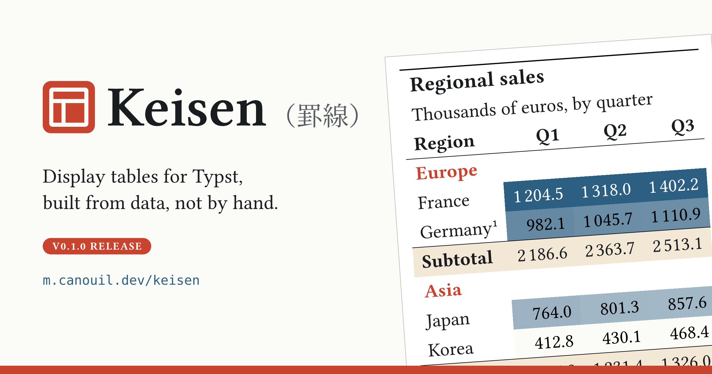

[Keisen](https://github.com/mcanouil/keisen) 0.1.0 is out on Typst Universe.
It is a Typst package for display tables: the kind of table you put in a report or a paper, with a title, grouped rows, formatted numbers, and footnotes.

{
  .img-featured
  .img-fluid
  fig-align="center"
  fig-alt=''
  width="600px"
}

I have used [`gt`](https://gt.rstudio.com) in R since its early days, and [`great_tables`](https://posit-dev.github.io/great-tables/) in Python since it came out.
When I write in Typst, I miss them.
Typst's `table()` is good at layout, but every number is yours to format, cell by cell.
Rounding, padding the decimals, adding the currency symbol, numbering the footnotes: you type all of it.
I wanted the same feeling as `gt` in Typst: you say what each column is, and the package writes the cells.

The name comes from Japanese.
_Keisen_ (罫線) means the ruled lines of a table.

::: {.callout-note}

## TL;DR

Keisen brings the `gt` way of building tables to Typst: you describe the columns, and Keisen formats the cells.
Get it with `#import "@preview/keisen:0.1.0": *`, and read the [documentation](https://m.canouil.dev/keisen).

:::

Every table in this post is compiled from its code when the post renders, with Keisen 0.1.0.

## Plain Typst Against Keisen

Here is a baseline characteristics table, the first table of most clinical trial reports.
Continuous variables show the mean and the standard deviation, categorical variables show the count and the percentage.

```{typst}
//| file: assets/typst/gallery-clinical-keisen.typ
//| output-filename: "clinical.svg"
//| alt: "Baseline characteristics table titled 'Baseline characteristics', subtitle 'Randomised population, by treatment arm'. Rows are grouped under Demographics and Disease history, with age, sex, body mass index, smoking, HbA1c, diabetes duration, prior myocardial infarction, and hypertension. Two columns, Drug (n = 120) and Placebo (n = 118), sit under a 'Treatment arm' spanner with footnote mark 1, and each cell reads as mean (SD) or n (%). A footnote and a source note close the table."
```

I wrote it twice, from the same data.
Both versions draw the table above.
The data is the same in both, so it is left out of the two listings below.

::: {.code-compare .column-page-inset layout-ncol="2"}

```{.typst filename="Plain Typst" include="assets/typst/gallery-clinical-native.typ" start-line=26 end-line=78}
```

```{.typst filename="Keisen" include="assets/typst/gallery-clinical-keisen.typ" start-line=28 end-line=66}
```

:::

The plain Typst version is long because every decision is written out.
A `fixed()` helper rounds a float and pads the zeros the float dropped.
A loop glues the mean and the standard deviation into one cell, and another one adds a full-width row for each group.
The footnote mark is a `#super[1]` typed by hand, in two places that have to agree.

In Keisen, each of those is one call.
`format-number()` picks the rows by what they hold (`row.kind == "mean"`), `columns-combine()` merges two columns into "value (spread)", and `table-footnote()` places and numbers the mark.
None of these calls says where a cell is or how it looks.

::: {.highlight}

**Less to type, less to fix:** no cell is typed by hand, so when the data changes, the table follows it.

:::

## A Results Table, the `gt` Way

The second table of the same report is often a regression table.
I will build it one step at a time, the way I would in `gt`.
Each step adds a few calls to the same `display-table()`, and the `gt` function that does the same job is named next to it.

The data is one Typst dictionary, one array per column: the estimate, the bounds of the 95% confidence interval, and the _p_-value, for an unadjusted and an adjusted model.

```{.typst include="assets/typst/regression-steps.typ" start-line=6 end-line=22}
```

### The Default Table

With no other argument, `display-table()` already draws a table, like `gt()` on a data frame.
Every array becomes a column, and the column names come straight from the dictionary keys.

```{typst}
//| output-filename: "regression-0.svg"
//| alt: "The regression data as a default table: no title, a lowercase 'term' column, and eight more columns named crude, crude-lower, crude-upper, crude-p, adjusted, adjusted-lower, adjusted-upper, and adjusted-p. The values are raw floats, such as -0.2 next to -0.24, and 0.000021 next to 0.61."
#import "assets/typst/regression-steps.typ": *
#display-table(data)
```

The numbers come straight from the floats, so `−0.2` sits under `−0.24`, and `0.000021` sits next to `0.61`.

### Header and Stub

`table-header()` adds the title and the subtitle, like `tab_header()`.
`table-stub()` makes the `term` column the row labels, like `rowname_col` in `gt()`.
From here on, the cells a step changes are shaded in yellow in the render.
The shading only marks the change, and it is not part of the code.

::: {.code-compare .column-page-inset layout-ncol="2"}

::: {}

```{.typst filename="Header" include="assets/typst/regression-steps.typ" start-line=25 end-line=28}
```

```{typst}
//| output-filename: "regression-1a.svg"
//| alt: "The same table with the title 'Change in HbA1c at 26 weeks' and the subtitle 'Linear regression, percentage points' added above the columns, both shaded in yellow. The 'term' column is still an ordinary column."
#import "assets/typst/regression-steps.typ": *
#display-table(data, ..header, ..changed(cells-title()))
```

:::

::: {}

```{.typst filename="Stub" include="assets/typst/regression-steps.typ" start-line=32 end-line=32}
```

```{typst}
//| output-filename: "regression-1b.svg"
//| alt: "The same table with the term column turned into the stub: its label now reads 'Term', and the label and the five row names are shaded in yellow."
#import "assets/typst/regression-steps.typ": *
#display-table(data, ..header, ..stub, ..changed(cells-stubhead(), cells-stub()))
```

:::

:::

### Numbers

`format-number()` is `fmt_number()`.
It takes column names, or a function that picks columns by name, so one call covers every estimate and bound, and another covers the _p_-values.
`format()` with a `rows` condition writes `< 0.001` for the small _p_-values, the job of `sub_small_vals()`.

```{.typst include="assets/typst/regression-steps.typ" start-line=36 end-line=42}
```

```{typst}
//| output-filename: "regression-2.svg"
//| alt: "The regression table with formatted numbers, the whole body shaded in yellow: estimates and bounds with two decimals, p-values with three decimals, and p-values below 0.001 written as '< 0.001'. The raw column names are still in the header."
#import "assets/typst/regression-steps.typ": *
#display-table(data, ..header, ..stub, ..numbers, ..changed(cells-body()))
```

### Columns and Spanners

`columns-combine()` merges the two bounds into one "95% CI" column, like `cols_merge()`.
`columns-label()` is `cols_label()`, and `table-spanner()` is `tab_spanner()`.

```{.typst include="assets/typst/regression-steps.typ" start-line=46 end-line=65}
```

```{typst}
//| output-filename: "regression-3.svg"
//| alt: "The regression table with six columns: Estimate, 95% CI, and p under an 'Unadjusted' spanner, and the same three under an 'Adjusted' spanner. The spanners, the new labels, and the two combined confidence interval columns, each reading as 'lower, upper', are shaded in yellow."
#import "assets/typst/regression-steps.typ": *
#display-table(
  data,
  ..header,
  ..stub,
  ..numbers,
  ..columns,
  ..changed(
    cells-column-spanners(),
    cells-column-labels(),
    cells-body(columns: ("crude-interval", "adjusted-interval")),
  ),
)
```

The combined column reads the formatted bounds, so they keep their two decimals.

### Style from the Data

`table-style()` is `tab_style()`.
The location says which cells: the adjusted columns, in the rows where the adjusted _p_-value is below 0.05.

```{.typst include="assets/typst/regression-steps.typ" start-line=69 end-line=75}
```

```{typst}
//| output-filename: "regression-4.svg"
//| alt: "The regression table with the adjusted estimate, interval, and p-value in bold and shaded in yellow for Treatment, Age per 10 years, and Body mass index, the three rows with an adjusted p-value below 0.05."
#import "assets/typst/regression-steps.typ": *
#display-table(
  data,
  ..header,
  ..stub,
  ..numbers,
  ..columns,
  ..emphasis,
  ..changed(cells-body(
    columns: ("adjusted", "adjusted-interval", "adjusted-p"),
    rows: row => row.adjusted-p < 0.05,
  )),
)
```

If the data changes, the bold follows it.
There is no row number to update.

### Notes and Theme

`table-footnote()` is `tab_footnote()`, here attached to the "Adjusted" spanner, and `table-source-note()` is `tab_source_note()`.
The `theme` argument plays the part of `opt_stylize()`: `theme-booktabs()` draws the three rules of a publication table.

```{.typst include="assets/typst/regression-steps.typ" start-line=79 end-line=83}
```

```{typst}
//| output-filename: "regression-5.svg"
//| alt: "The final regression table in the booktabs theme, with a thick rule above and below and a thin rule under the column labels. The 'Adjusted' spanner carries footnote mark 1, and the table ends with the source note 'Source: synthetic trial data.' and the footnote 'Adjusted for every other term in the table.', both shaded in yellow."
#import "assets/typst/regression-steps.typ": *
#display-table(
  data,
  ..header,
  ..stub,
  ..numbers,
  ..columns,
  ..emphasis,
  ..notes,
  ..changed(cells-footnotes(), cells-source-notes()),
  theme: theme-booktabs(),
)
```

If you know `gt` or `great_tables`, most of Keisen will feel familiar, with hyphens in place of underscores.

## Other Features

The two tables above leave out a good part of the first release.
The Keisen website has an example page for each feature, with the code and a few words on when to use it.
Each miniature below links to its page.

::: {layout-ncol="3"}

::: {.pb-3 .d-flex .flex-column .align-self-stretch}

::: {.card .flex-grow-1}

::: {.card-header .small}

[Four themes](https://m.canouil.dev/keisen/reference/themes.html)

:::

::: {.card-body .d-flex .align-items-center .justify-content-center}

```{typst}
//| file: assets/typst/themes.typ
//| output-filename: "themes.svg"
//| classes: ""
//| group: "features"
//| description: "Four themes."
//| alt: "The same three-row fuel consumption table drawn four times, once per theme: theme-default with rules around the header and body, theme-booktabs with three rules, theme-compact with tighter rows, and theme-minimal with a single thin rule under the labels."
```

:::

:::

:::

::: {.pb-3 .d-flex .flex-column .align-self-stretch}

::: {.card .flex-grow-1}

::: {.card-header .small}

[Colour from the data, and a cell that fails a threshold](https://m.canouil.dev/keisen/examples/mark-a-failing-cell.html)

:::

::: {.card-body .d-flex .align-items-center .justify-content-center}

```{typst}
//| file: assets/typst/styled.typ
//| output-filename: "styled.svg"
//| classes: ""
//| group: "features"
//| description: "Colour from the data, and a cell that fails a threshold."
//| alt: "A regional sales table with the Units column shaded from pale to dark blue by value, a margin below 5% in bold red, a missing margin shown as a dash, and two numbered footnotes."
```

:::

:::

:::

::: {.pb-3 .d-flex .flex-column .align-self-stretch}

::: {.card .flex-grow-1}

::: {.card-header .small}

[Summary rows, and a total that stands out](https://m.canouil.dev/keisen/examples/highlight-a-total.html)

:::

::: {.card-body .d-flex .align-items-center .justify-content-center}

```{typst}
//| file: assets/typst/summaries.typ
//| output-filename: "summaries.svg"
//| classes: ""
//| group: "features"
//| description: "Summary rows, and a total that stands out."
//| alt: "Two tables. The first, 'Regional sales', groups products under North and South with a shaded subtotal row per region, and a grand total whose revenue is in blue with a footnote mark. The second has no stub, its first column at the end edge, and a total row."
```

:::

:::

:::

::: {.pb-3 .d-flex .flex-column .align-self-stretch}

::: {.card .flex-grow-1}

::: {.card-header .small}

[An estimate with its error](https://m.canouil.dev/keisen/examples/estimate-with-its-error.html)

:::

::: {.card-body .d-flex .align-items-center .justify-content-center}

```{typst}
//| file: assets/typst/combined.typ
//| output-filename: "combined.svg"
//| classes: ""
//| group: "features"
//| description: "An estimate with its error."
//| alt: "An 'Association results' table for four genes, with the effect and its standard error in one column, the 95% confidence interval as a range, and p-values in scientific notation."
```

:::

:::

:::

::: {.pb-3 .d-flex .flex-column .align-self-stretch}

::: {.card .flex-grow-1}

::: {.card-header .small}

[A trend inside a cell](https://m.canouil.dev/keisen/examples/trend-inside-a-cell.html)

:::

::: {.card-body .d-flex .align-items-center .justify-content-center}

```{typst}
//| file: assets/typst/nanoplots.typ
//| output-filename: "nanoplots.svg"
//| classes: ""
//| group: "features"
//| description: "A trend inside a cell."
//| alt: "A portfolio table with a sparkline and a bar plot per row, the asset name and the weight centred against the plots beside them: equities rising, bonds falling, and cash nearly flat."
```

:::

:::

:::

::: {.pb-3 .d-flex .flex-column .align-self-stretch}

::: {.card .flex-grow-1}

::: {.card-header .small}

[A plot in a sentence](https://m.canouil.dev/keisen/examples/plot-in-a-sentence.html)

:::

::: {.card-body .d-flex .align-items-center .justify-content-center}

```{typst}
//| file: assets/typst/nanoplots-inline.typ
//| output-filename: "nanoplots-inline.svg"
//| classes: ""
//| group: "features"
//| description: "A plot in a sentence."
//| alt: "A sentence about revenue with a small line plot, a dot plot, and a bar plot set inline at the height of the text, then the same line plot again at a larger text size."
```

:::

:::

:::

::: {.pb-3 .d-flex .flex-column .align-self-stretch}

::: {.card .flex-grow-1}

::: {.card-header .small}

[Numbers the local way](https://m.canouil.dev/keisen/examples/numbers-the-local-way.html)

:::

::: {.card-body .d-flex .align-items-center .justify-content-center}

```{typst}
//| file: assets/typst/conventions.typ
//| output-filename: "conventions.svg"
//| classes: ""
//| group: "features"
//| description: "Numbers the local way."
//| alt: "A table titled 'Dépenses' written the French way: amounts with a comma as the decimal mark, a thin space between thousands, and the euro sign after the number, an infinity sign for an unbounded ratio, and charges in scientific notation."
```

:::

:::

:::

::: {.pb-3 .d-flex .flex-column .align-self-stretch}

::: {.card .flex-grow-1}

::: {.card-header .small}

[Values in their own notation](https://m.canouil.dev/keisen/examples/values-in-their-own-notation.html)

:::

::: {.card-body .d-flex .align-items-center .justify-content-center}

```{typst}
//| file: assets/typst/formatters.typ
//| output-filename: "formatters.svg"
//| classes: ""
//| group: "features"
//| description: "Values in their own notation."
//| alt: "A 'Bill of materials' table with prices aligned under their currency symbols, charges in scientific notation with the exponents aligned, and firmware sizes with their units aligned. Below it, the same figures with the symbol trailing, the exponent written with an e, and sizes counted in thousands."
```

:::

:::

:::

::: {.pb-3 .d-flex .flex-column .align-self-stretch}

::: {.card .flex-grow-1}

::: {.card-header .small}

[Right to left](https://m.canouil.dev/keisen/examples/right-to-left.html)

:::

::: {.card-body .d-flex .align-items-center .justify-content-center}

```{typst}
//| file: assets/typst/direction.typ
//| output-filename: "direction.svg"
//| classes: ""
//| group: "features"
//| description: "Right to left."
//| alt: "The same grouped 'Readings' table twice, once left to right and once right to left, with the stub, the columns, and the alignment mirrored in the second one."
```

:::

:::

:::

:::

A row group that runs past the end of a page reprints its label on the next page, because Keisen draws groups as native repeating subheaders.
A single picture does not show that well, so see [Carry a table across pages](https://m.canouil.dev/keisen/examples/table-across-pages.html).

The website also has a gallery of six full tables, each next to its plain Typst version.
Here are the four tables I have not shown yet.

::: {layout-ncol="4"}

::: {.pb-3 .d-flex .flex-column .align-self-stretch}

::: {.card .flex-grow-1}

::: {.card-header .small}

[Income statement](https://m.canouil.dev/keisen/gallery/income-statement.html)

:::

::: {.card-body .d-flex .align-items-center .justify-content-center}

```{typst}
//| file: assets/typst/gallery-income-statement-keisen.typ
//| output-filename: "gallery-income-statement.svg"
//| classes: ""
//| group: "gallery"
//| description: "Income statement."
//| alt: "An income statement in pounds sterling for 2025 and 2026, with revenue and operating cost lines, a subtotal per section, and an operating profit row on a grey background."
```

:::

:::

:::

::: {.pb-3 .d-flex .flex-column .align-self-stretch}

::: {.card .flex-grow-1}

::: {.card-header .small}

[Population by region](https://m.canouil.dev/keisen/gallery/population.html)

:::

::: {.card-body .d-flex .align-items-center .justify-content-center}

```{typst}
//| file: assets/typst/gallery-population-keisen.typ
//| output-filename: "gallery-population.svg"
//| classes: ""
//| group: "gallery"
//| description: "Population by region."
//| alt: "A 'Population by region' table of 2025 mid-year estimates for the regions of England, with the population, the share of England, a small age-profile bar plot per row, and the median age."
```

:::

:::

:::

::: {.pb-3 .d-flex .flex-column .align-self-stretch}

::: {.card .flex-grow-1}

::: {.card-header .small}

[League standings](https://m.canouil.dev/keisen/gallery/standings.html)

:::

::: {.card-body .d-flex .align-items-center .justify-content-center}

```{typst}
//| file: assets/typst/gallery-standings-keisen.typ
//| output-filename: "gallery-standings.svg"
//| classes: ""
//| group: "gallery"
//| description: "League standings."
//| alt: "A league table after 14 rounds, with the top two teams shaded green and the bottom team shaded red, the goal difference shaded on a diverging scale, and a small line of the last five results per team."
```

:::

:::

:::

::: {.pb-3 .d-flex .flex-column .align-self-stretch}

::: {.card .flex-grow-1}

::: {.card-header .small}

[Laboratory assay](https://m.canouil.dev/keisen/gallery/assay.html)

:::

::: {.card-body .d-flex .align-items-center .justify-content-center}

```{typst}
//| file: assets/typst/gallery-assay-keisen.typ
//| output-filename: "gallery-assay.svg"
//| classes: ""
//| group: "gallery"
//| description: "Laboratory assay."
//| alt: "A 'Drinking water assay' table for eight sites, with lead, cadmium, and gross alpha readings, lead values above the regulatory limit in bold red, and 'n.d.' for readings not detected."
```

:::

:::

:::

:::

## Installation

Keisen is on Typst Universe, and it imports no other package:

```typst
#import "@preview/keisen:0.1.0": *
```

The documentation has a reference page for every function, the examples, and the gallery.
It also ships a copy for language models at [`llms.txt`](https://m.canouil.dev/keisen/llms.txt).

- Repository: [mcanouil/keisen](https://github.com/mcanouil/keisen).
- Documentation: [m.canouil.dev/keisen](https://m.canouil.dev/keisen).
- Typst Universe: [@preview/keisen](https://typst.app/universe/package/keisen).

::: {.callout-tip}

## A note on contributions

Keisen is an unfunded spare-time project, and the API is still settling.
Bug reports are welcome on the [issue tracker](https://github.com/mcanouil/keisen/issues/new/choose), and ideas and questions in [Discussions](https://github.com/mcanouil/keisen/discussions/new/choose).
I do not accept pull requests for now, and I will say so in the README when that changes.

:::

If you build a table with Keisen, I would like to see it in the [Show and tell](https://github.com/mcanouil/keisen/discussions/categories/show-and-tell) category of Discussions.
