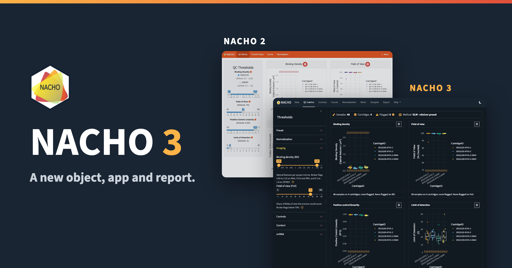{
  .img-featured
  .img-fluid
  fig-align="center"
  fig-alt=''
  width="600px"
}

**NACHO 3.0** is on CRAN.
NACHO reads NanoString nCounter data, flags the samples that fail quality control, and normalises the counts.

::: {.callout-note}

## History

The name stands for NAnoString quality Control dasHbOard.
We published it in *Bioinformatics* in 2020 [@canouil_nacho_2020].
Gerard Bouland and Roderick Slieker are co-authors of the package.
The original development, described in the article, was funded by the [RHAPSODY consortium](https://www.imi-rhapsody.eu/consortium/), as part of the Innovative Medicines Initiative 2 Joint Undertaking (grant agreement No 115881).
All development since then, including NACHO 3.0, was unfunded open source work.

:::

I described the way I structure this kind of package in [R Package Architecture: Shiny, Quarto, targets, and S7](/posts/2026-07-01-r-package-shiny-quarto/).
NACHO 3.0 follows part of that pattern, with an S7 object, a modular Shiny app and a Quarto report.

This release rebuilds the object, the Shiny app, the report and the website.
This post compares it with NACHO 2.0, so you can see what changed and decide when to move.

::: {.highlight}

**NACHO 3.0** is available from CRAN with `install.packages("NACHO")`, and the [package website](https://m.canouil.dev/NACHO/) has the documentation.

:::

## Why NACHO 3.0

NACHO 2.0 did its job, but three things got in the way.

- The object was a big S3 list.
  The counts, the samples and the probes lived in one long table called `$nacho`, and every sample column was repeated on every probe row.
  It was hard to read and hard to subset.
- The app and the website looked dated.
  Their style and their chrome had aged, and the two did not match.
- The report could be better.
  Quarto and Typst make a much better report possible, as a self-contained HTML file and as a PDF.

## The Object

`load_rcc()` and `normalise()` now return an S7 object of class `nacho`.
In NACHO 2.0 the same call gave a list, and `$nacho` held 3456 rows and 86 columns for the 72 probes of 48 samples.

```r
# With NACHO 2.0 installed
x <- NACHO::GSE74821
dim(x$nacho)
#> [1] 3456   86
```

In NACHO 3.0 the object keeps the counts, the samples and the probes apart, and you read each one with an accessor.

```r
library(NACHO)

x <- GSE74821
x
#> <nacho> 48 samples, 72 probes, from single-sample RCC files
#> Normalisation: GLM, with 8 housekeeping genes
#> Flagged samples: 0 of 48
#> Created with NACHO 3.0.0

dim(nacho_counts(x))
#> [1] 72 48
```

`nacho_counts()` returns a matrix, `nacho_samples()` and `nacho_probes()` return one row per sample and per probe, and `as.data.frame(x, long = TRUE)` gives the old long table back when you need it for `ggplot2` or `dplyr`.

::: {.highlight}

**One object, one accessor for each question:** `nacho_counts()`, `nacho_samples()`, `nacho_probes()` and `nacho_qc()` replace the long `$nacho` table, and the long layout is one call away.

:::


The quality-control flags changed too.
`nacho_qc()` gives one row per sample, with a status for each metric, the number of flags and a readable reason.

```r
head(nacho_qc(x)[, c("status", "n_flags", "reason")], n = 3)
#>   status n_flags reason
#> 1   pass       0   <NA>
#> 2   pass       0   <NA>
#> 3   pass       0   <NA>
```

You can also subset the object like a matrix.
`x[, 1:12]` keeps the first twelve samples and `x[1:20, ]` keeps the first twenty probes, and both compute the PCA and the flags again.

## A New App

The two screenshots below show the same page, the quality-control metrics, in NACHO 2.0 and in NACHO 3.

::: {layout-ncol="2" style="text-align:center;"}

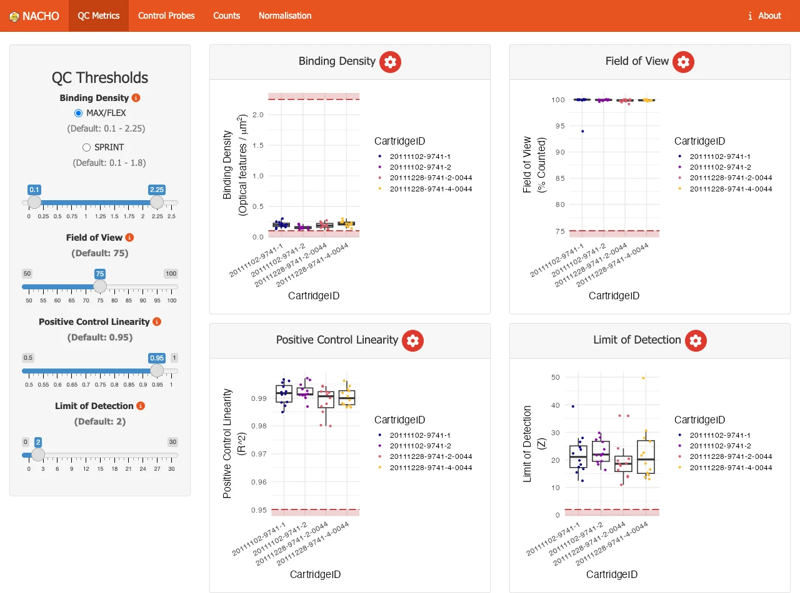{
  group="nacho-3"
  .img-fluid .hero-art
  fig-align="center"
  fig-alt=''
}

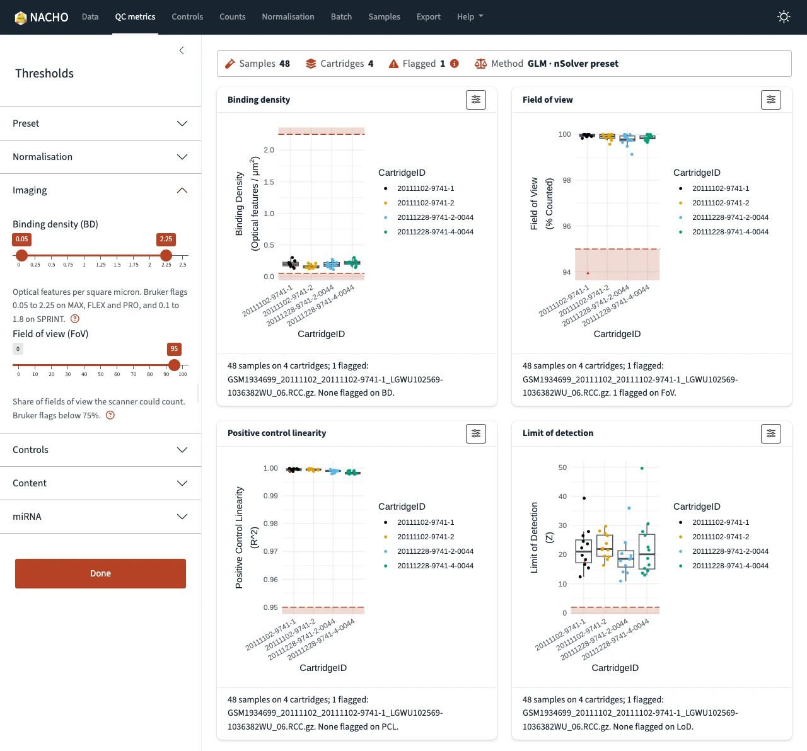{
  group="nacho-3"
  .img-fluid .hero-art
  fig-align="center"
  fig-alt=''
}

:::

The app now has one navy navbar with eight pages, and one sidebar that holds every threshold.
The sidebar folds its sections, and each page opens the section that matches it.
A summary strip at the top of every page shows the samples, the cartridges, the flagged samples with their reasons, and the method.
Each plot sits in a card that opens full screen, and a toggle in the navbar switches the whole app to dark mode.

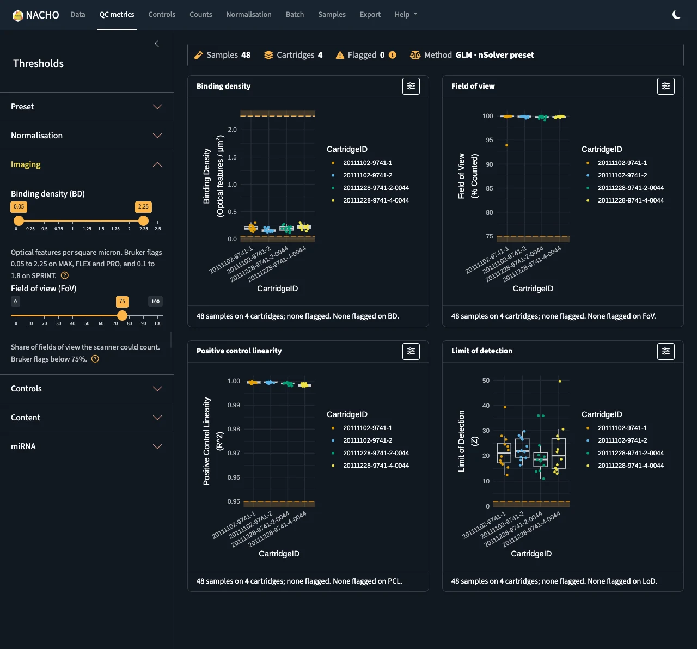{
  group="nacho-3"
  .img-fluid .hero-art
  fig-align="center"
  style="max-width: 600px;"
  fig-alt=''
}

The recording below shows a short session on the example data.

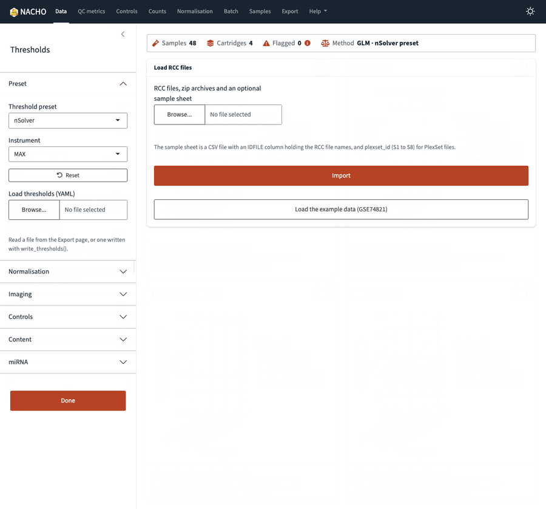{
  group="nacho-3"
  .img-fluid .hero-art
  fig-align="center"
  style="max-width: 600px;"
  fig-alt=''
}

### Guided Tour

The Help menu in the navbar starts a guided tour of the app.
When no data are loaded, the tour loads the example data first.

::: {style="text-align: center; padding-bottom: 1rem;"}

```{=html}
<!-- Raw HTML, not the video shortcode: for a local file the shortcode adds Video.js and a single source, sets preload="auto" and has no poster, muted, loop or playsinline option. -->
<video class="hero-art" style="width: 600px; max-width: 100%; height: auto; margin-bottom: 1.5rem;" controls muted loop playsinline preload="metadata" poster="assets/media/app-tour-poster.webp" aria-label=''>
  <source src="assets/media/app-tour.mp4" type="video/mp4">
</video>
```

:::

Each threshold has a help popover next to it, and the pages without data say what to do.
Errors from an upload and warnings from the normalisation show once, as toasts.

### Loading Data

When you choose files, the Data page lists the RCC files of the upload before you import anything.
It also looks inside zip archives, and says for each file whether it is a PlexSet file and whether the sample sheet lists it.

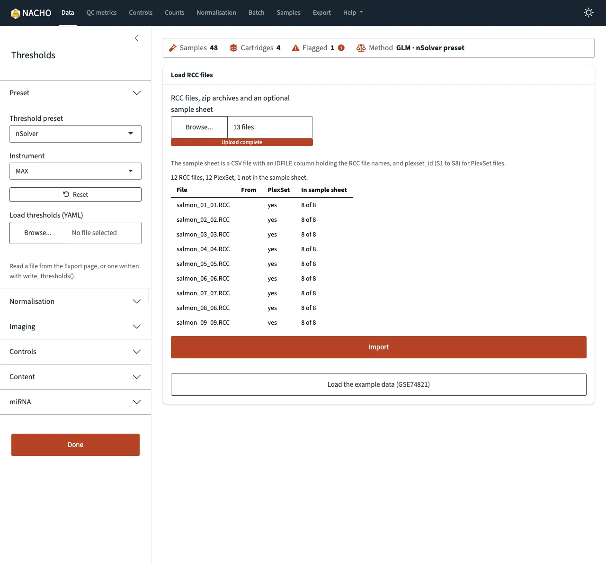{
  group="nacho-3"
  .img-fluid .hero-art
  fig-align="center"
  style="max-width: 600px;"
  fig-alt=''
}

### Samples

The Samples page lists every sample in one table, with the flagged ones first and the status as a coloured word.
With `reactable` installed, you can sort and search the table, and a click on a row selects that sample in the plots.
With `ggiraph` installed, hovering over a point shows the sample, and clicking it outlines that sample in every plot.

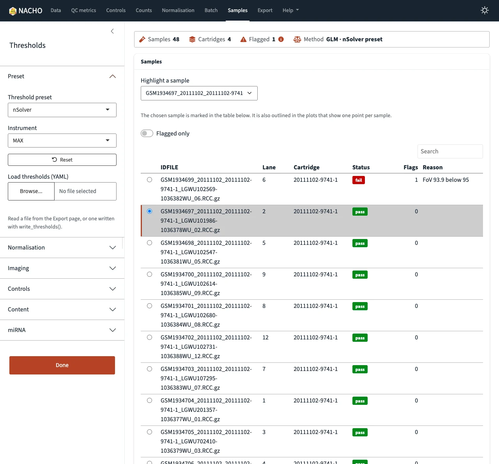{
  group="nacho-3"
  .img-fluid .hero-art
  fig-align="center"
  style="max-width: 600px;"
  fig-alt=''
}

### Export

The Export page writes the thresholds you tuned to a YAML file, and the Preset section of the sidebar loads that file again, so one set of limits can serve every study.
The same page downloads the quality-control table, the object and the report.
The report renders in the background when `mirai` is installed, so the app stays usable.

The Export page also has a **Reproduce in R** card.
It shows an R script that repeats your session with `load_rcc()`, `normalise()` and the thresholds you set.

::: {.highlight}

**What you tune in the app, you can take with you:** the thresholds go to a YAML file, and the session goes to an R script that repeats it.

:::


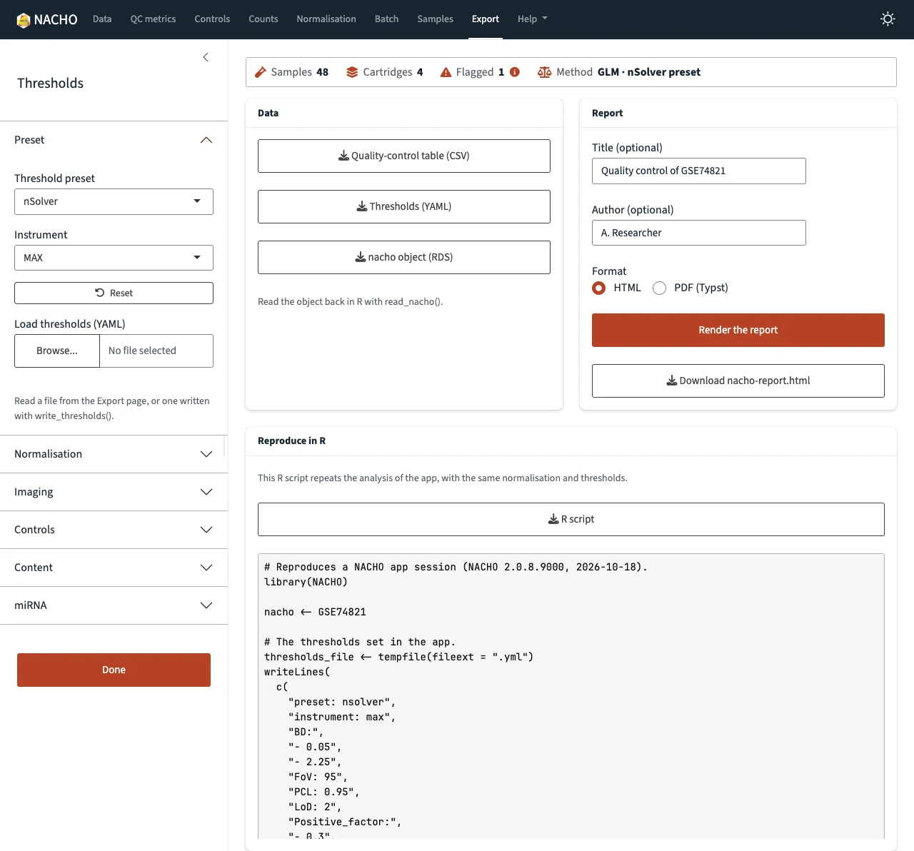{
  group="nacho-3"
  .img-fluid .hero-art
  fig-align="center"
  style="max-width: 600px;"
  fig-alt=''
}

### Responsiveness

The app stays responsive while it computes, thanks to [mirai](https://mirai.r-lib.org/), the asynchronous framework of Charlie Gao (@shikokuchuo).
NACHO 3.0 suggests `mirai` and does not require it, so the app runs without it.
When `mirai` is installed, the app hands three jobs to background R processes, and the page keeps answering you.

- Importing: reading the RCC files no longer freezes the page, and the line under **Import** shows the current stage.
- Reporting: the Export page renders the HTML or PDF report in the background.
- Plotting: the plots of a page are built at the same time, by plot workers that all users of the app share.

The plots gain the most.
If you change a threshold while the plots of a page are still building, the app stops the older builds, so you only wait for the plots of the last values.
A finished plot goes into a cache that the workers share, so going back to a page, or to settings you already used, shows it at once.

On my machine, the four plots of the QC metrics page appear in about 0.7 seconds with the plot workers.
With `nacho.plot_workers` set to `0`, which builds them in the app process, they take about 3.5 seconds.
Those are three runs of each, with a fresh start of the app every time.

::: {.highlight}

**The plots no longer hold the app:** with `mirai`, the QC metrics plots appear about five times faster, and a changed threshold stops the older builds.

:::


By default the app starts one plot worker for each CPU core minus one, with a maximum of four, and an app from `deploy()` starts one.
Each worker keeps a copy of the study, and for the example data that is about 170 MB per worker.
The `nacho.plot_workers` option sets the number of workers.

```r
options(nacho.plot_workers = 2)
visualise(GSE74821)
```

The NACHO 2.0 app had no import page and no report export, and it drew its plots one after the other in the app process.
A long computation therefore held the whole page until it ended.
Without `mirai`, NACHO 3.0 does the same for the import and the report, and falls back to the app process for the plots.

## A New Website

The website got the same treatment as the app.
Here is the home page in NACHO 2.0 and in NACHO 3.0.

::: {layout-ncol="2" style="text-align:center;"}

::: {}

::: {.hero-art style="display: block; max-height: 480px; overflow-y: auto; padding: 0;"}

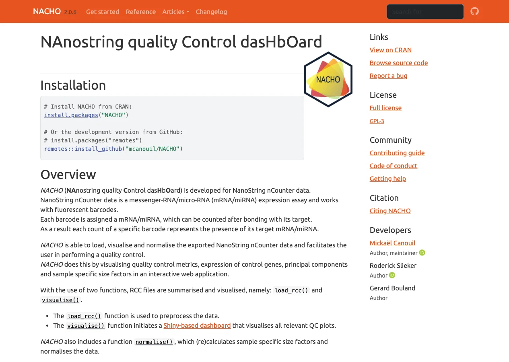{
  .nolightbox
  .img-fluid
  fig-alt=''
}

:::

**NACHO 2.0**

:::

::: {}

::: {.hero-art style="display: block; max-height: 480px; overflow-y: auto; padding: 0;"}

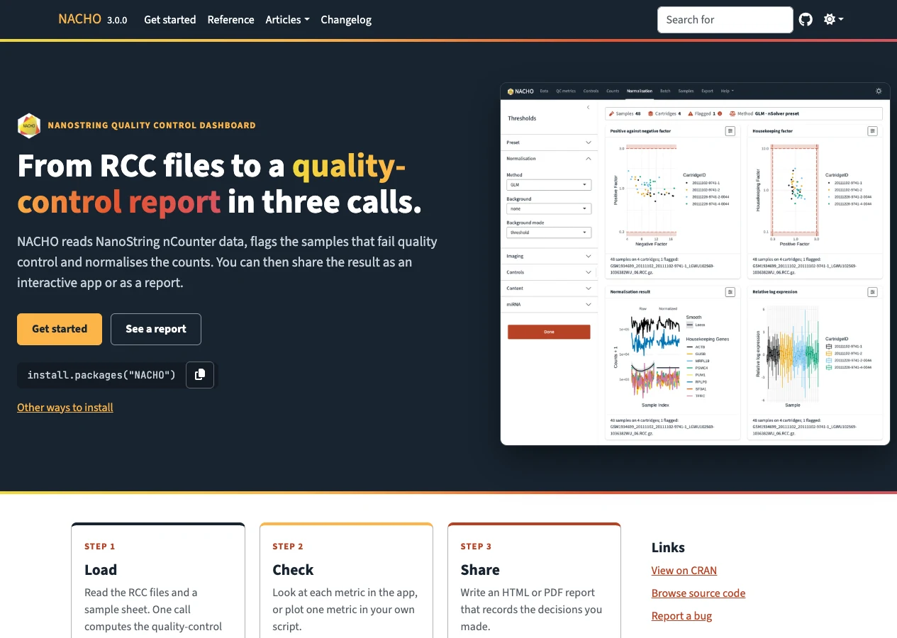{
  .nolightbox
  .img-fluid
  fig-alt=''
}

:::

**NACHO 3.0**

:::

:::

Each screenshot is the whole page, so scroll inside a frame to read it.

The app, the report and the website now share one brand file, with the Source Sans 3 and JetBrains Mono fonts.
The package ships that file, so the three look the same, even offline.
The website also follows your light or dark preference.

::: {style="text-align: center;"}

::: {.hero-art style="display: block; max-height: 480px; overflow-y: auto; padding: 0; max-width: 600px; margin-bottom: 2.5rem;"}

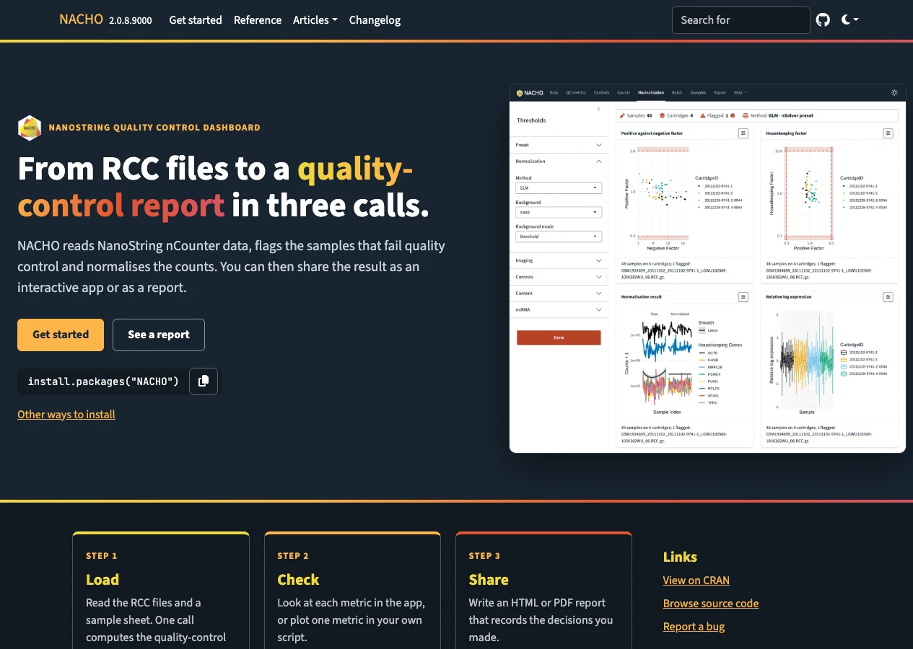{
  .nolightbox
  .img-fluid
  fig-alt=''
}

:::

:::

The plots follow the brand as well.
Groups take the Okabe-Ito colours, a palette designed for colour vision deficiency, and a flagged sample is a rust triangle instead of a red point.

## A Better Report

`render()` now builds the report with Quarto, and not with R Markdown.
The same content comes out as a self-contained HTML file, or as a PDF made by Typst with `format = "typst"`.

```r
render(x, output_dir = "reports", title = "Example study", author = "Your Name")
render(x, output_dir = "reports", format = "typst")
```

The report is now a quality-control record.
Here are the tops of the NACHO 2.0 and the NACHO 3.0 HTML reports.

::: {layout-ncol="2" style="text-align:center;"}

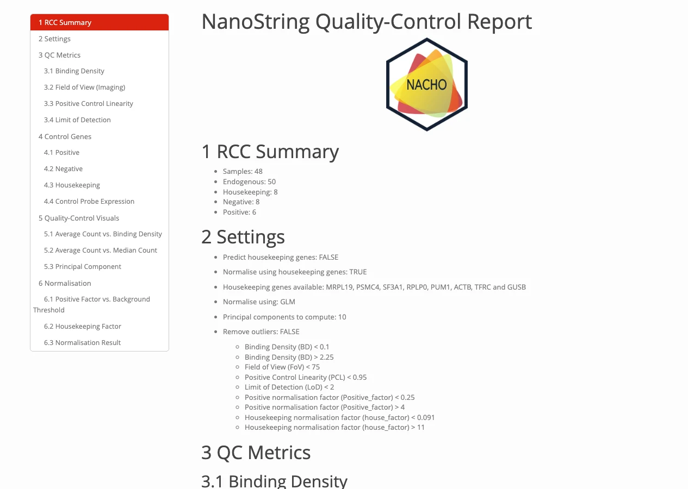{
  group="nacho-3"
  .img-fluid .hero-art
  fig-align="center"
  fig-alt=''
}

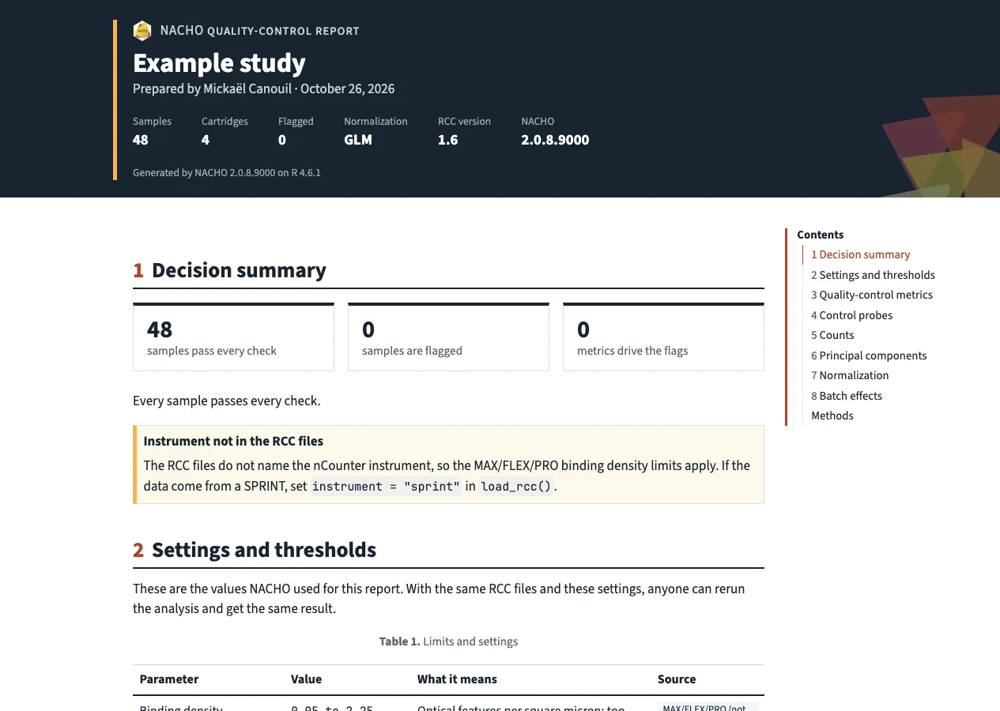{
  group="nacho-3"
  .img-fluid .hero-art
  fig-align="center"
  fig-alt=''
}

:::

It opens with a cover that holds the study details, then a summary of the decision with the flagged samples.
A table lists every setting and limit with its meaning and its source.
Each figure and table has a short "How to read this", and an appendix gives the methods, the citation and the package versions.
With `group`, the report adds the batch design and warns when the batches and the biology are confounded.

The PDF has the same content and the same look.
It is a tagged PDF that declares PDF/UA-1, and Typst checks it against the rules of that standard that it can enforce.
The HTML report has landmarks, a skip link and labelled tables.

::: {.highlight}

**One report, two formats:** the same Quarto content comes out as a self-contained HTML file and as a tagged PDF (PDF/UA-1) made by Typst.

:::

Below is the PDF of the example data.

::: {style="text-align: center;"}

{
  .hero-art
  .slide-deck
  style="width: 400px; aspect-ratio: 210 / 297;"
  loading="lazy"
  aria-label="Typst PDF report of the NACHO example data"
}

:::

Open it full size: [Typst PDF](assets/output/nacho-report.pdf){target="_blank" rel="noopener noreferrer"}.

::: {.callout-note}

The report needs the Quarto command-line interface 1.9.18 or newer.
RStudio and Positron bundle it.

:::

## Changes in Results

The same RCC files can give a different answer in NACHO 3.0, so here is what changes by default.

- Samples are flagged against the nSolver thresholds, where NACHO 2.0 used its own limits.
- Negative probes are excluded with Bruker's rule, which drops at most two probes that sit 3-fold above the others.
- Normalised counts are no longer rounded, and no longer floored at 0.1.
- There is no background correction by default.
- miRNA panels are no longer normalised with housekeeping genes by default, because their housekeeping mRNAs sit at background.

::: {.highlight}

**The defaults changed, so the results can change:** samples are now flagged against the nSolver thresholds, and `preset = "legacy"` gives back the NACHO 2.0 limits.

:::


If you need the NACHO 2.0 behaviour, the `legacy` preset gives back the old limits.
With a background correction on top, it also gives back the old outlier calls.

```r
nacho <- load_rcc(
  data_directory,
  ssheet_csv,
  id_colname = "IDFILE",
  preset = "legacy",
  background = "geo",
  background_mode = "subtract"
)
```

## Moving From NACHO 2.0

You do not have to move.
The last NACHO 2.0 release keeps working with the code you have, and you can pin it, for example with `renv::install("NACHO@2.0.8")`.
NACHO 3.0 needs R 4.3 or newer.

To move, convert the objects you saved.
`read_nacho()` reads a file saved by any NACHO version, and `upgrade_nacho()` converts an object that is already in your session.

```r
nacho <- read_nacho("nacho-2-object.rds")
```

The conversion keeps the raw counts, the sample sheet, the settings and the thresholds.
It then moves the object to the legacy preset, so the flags stay close to what NACHO 2.0 gave you.
Use `normalise()` when you want the nSolver preset.

A few calls changed as well.

- `autoplot(x, x = "BD")` is now `autoplot(x, type = "BD")`.
- `normalise(x, remove_outliers = TRUE)` is now `exclude_outliers(x)`.
- `x$nacho` is now `as.data.frame(x, long = TRUE)`.
- `deploy()` has no default `directory` any more.

The article [Moving from NACHO 2](https://m.canouil.dev/NACHO/articles/moving-from-nacho-2.html) on the website maps each NACHO 2.0 call to its NACHO 3.0 version.

## Other Changes

- Loading 768 samples takes about 2.5 seconds, against about 9 in NACHO 2.0.
- `nacho_thresholds()` builds the thresholds for the MAX, FLEX, PRO and SPRINT instruments, and `load_rcc()` reads the instrument from MAX and FLEX files.
- `normalisation_method = "RUVg"` removes unwanted variation, and `housekeeping_stability()` ranks the reference genes with geNorm and NormFinder.
- `batch_diagnostics()` crosses the study groups with the cartridges and the dates.
- `as_summarized_experiment()` and `as_nacho()` convert between a `nacho` object and a `SummarizedExperiment`.
- Errors, warnings and messages carry classes such as `nacho_error_bad_argument`, so your code can catch the ones it expects.

The [changelog](https://m.canouil.dev/NACHO/news/index.html) holds the full list.

Happy quality controlling!
