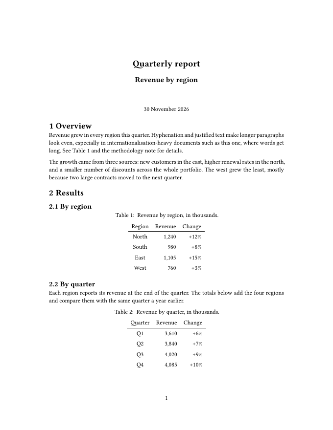
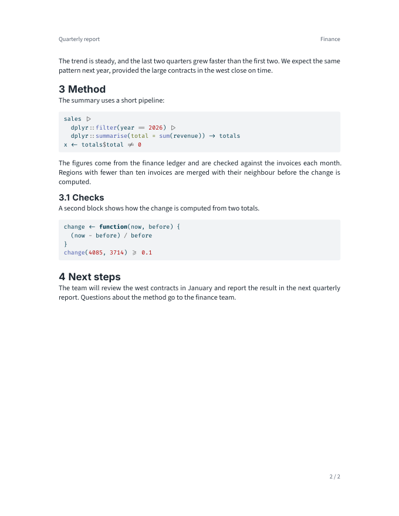

This post shows ten small Typst partials that change how a Quarto PDF looks.
Each one is a separate file, so you can copy it, edit it or remove it without touching the others.

{
  .img-featured
  .img-fluid
  fig-align="center"
  fig-alt=''
  width="600px"
}

## How Partials Work

Quarto builds a Typst PDF in two steps.
First, it turns your document into a Typst source file.
Then Typst compiles that file into the PDF.

A partial is a file that Quarto pastes into that Typst source.
It holds a few lines of Typst, such as a `set` rule or a `show` rule.
Quarto offers two ways to load one.

- `include-in-header` adds your file to the top of the Typst source, after Quarto's own setup.
  Your rules then apply to the whole document.
  The [Typst format page](https://quarto.org/docs/output-formats/typst.html) describes this option.
- `template-partials` replaces one of Quarto's own partials with your file, under the same name.
  The [custom Typst formats page](https://quarto.org/docs/output-formats/typst-custom.html) lists which partials you can replace.
  The [default partials](https://github.com/quarto-dev/quarto-cli/tree/main/src/resources/formats/typst/pandoc/quarto) are on GitHub, and they are the best place to read what you are replacing.

Nine of the ten tricks use `include-in-header`.
Only the title block needs `template-partials`.
If you want to go further and package your partials as an extension, my post on the [document dispatcher](/posts/2026-01-19-typst-document-dispatcher/index.qmd) is the next step.

::: {.callout-note}

The demo needs Quarto 1.9 or newer, because `pdf-standard` arrived in that version.
It also needs Typst 0.14 or newer, because `pdf.artifact()` arrived there.
Quarto 1.9 ships a Typst that is new enough.

:::

## The Demo Project

Here is the YAML of the demo, as it stands after the last trick.

```{.yaml filename="_quarto.yml"}
format:
  typst:
    pdf-standard: ua-1  # <1>
    include-in-header:  # <2>
      - partials/1-tokens.typ
      - partials/2-header-footer.typ
      - partials/3-headings.typ
      - partials/4-code.typ
      - partials/5-tables.typ
      - partials/6-captions.typ
      - partials/7-title-block.typ
      - partials/8-page-stripes.typ
      - partials/9-cover.typ
      - partials/10-cover-decoration.typ
    template-partials:
      - typst-show.typ
number-sections: true  # <3>
```

1. Ask Typst for a tagged PDF that follows PDF/UA-1.
   Typst stops with an error when something breaks the standard, so it guards every trick below.
2. Load the partials in this order.
   Removing a line removes that trick.
3. Number the headings through Quarto, which sets the numbering after the partials run.

The demo and the script that builds it are in the post folder, under `typst/`.
To build the PDF after each trick, run `typst/render-steps.sh` from that folder.

## Tokens {#tokens}

Keep every colour and font in one place, so changing a value changes the whole document.

```{.typst include="typst/partials/1-tokens.typ" filename="partials/1-tokens.typ"}
```

| Before | After |
| --- | --- |
| {.lightbox group="typst-tricks"} | {.lightbox group="typst-tricks"} |

::: {.callout-note}

## Contrast

I computed the WCAG 2.x contrast ratios of these colours with a short script.

- Ink on white is 14.76:1.
- Accent on white is 5.67:1, and so is white on accent.
- Muted on white is 6.18:1, and muted on the tint is 5.54:1.

Body text needs at least 4.5:1, so every pair passes.
Links are underlined, so they do not rely on colour alone.

:::

## Header and Footer {#header-footer}

Add a quiet running header and a page number in the form `n / total`.

```{.typst include="typst/partials/2-header-footer.typ" filename="partials/2-header-footer.typ"}
```

| Before | After |
| --- | --- |
| {.lightbox group="typst-tricks"} | {.lightbox group="typst-tricks"} |

::: {.callout-note}

## Size and context

The text is `0.85em` of the 11 pt body, which is about 9.35 pt, so it stays above 9 pt.
The page counter needs `context`, because its value is only known once Typst lays out the page.

:::

## Headings {#headings}

Colour the heading numbers and keep a heading from being stranded at the bottom of a page.

```{.typst include="typst/partials/3-headings.typ" filename="partials/3-headings.typ"}
```

| Before | After |
| --- | --- |
| {.lightbox group="typst-tricks"} | {.lightbox group="typst-tricks"} |

::: {.callout-note}

## Real headings

The partial restyles real headings, it does not fake them with big text, so the PDF keeps its heading structure.
The numbers come from `number-sections: true`, because Quarto's `article()` sets the numbering after the partials run.
The partial only styles the number.

:::

## Code {#code}

Show code in a calm light block that never splits across pages and never turns characters into symbols.

```{.typst include="typst/partials/4-code.typ" filename="partials/4-code.typ"}
```

| Before | After |
| --- | --- |
| {.lightbox group="typst-tricks"} | {.lightbox group="typst-tricks"} |

::: {.callout-note}

## Ligatures and page breaks

Code that looks different from what you typed is hard to read.
With only `ligatures: false`, Fira Code still drew `|>` as a triangle, so I also turn off the `calt` feature with `features: ("calt": 0)`.
The symbols `!=`, `<-` and `>=` then show as typed.
The `breakable: false` setting keeps a block on one page.

:::

## Tables {#tables}

Give tables a filled header and light stripes.

```{.typst include="typst/partials/5-tables.typ" filename="partials/5-tables.typ"}
```

| Before | After |
| --- | --- |
| {.lightbox group="typst-tricks"} | {.lightbox group="typst-tricks"} |

::: {.callout-note}

## Header row

The partial styles the header row, it does not replace it, so the table keeps its real header row.
Tagged PDFs rely on `table.header` to tell readers and screen readers which cells are headings.
The stripes only help the eye, because the header carries the meaning and colour is never the only signal.

:::
