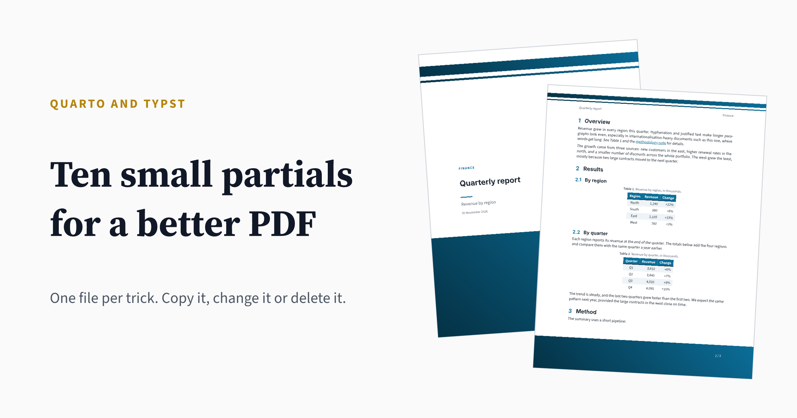
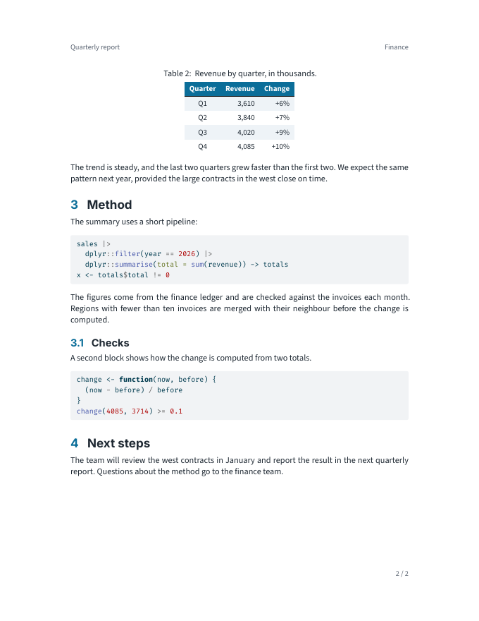
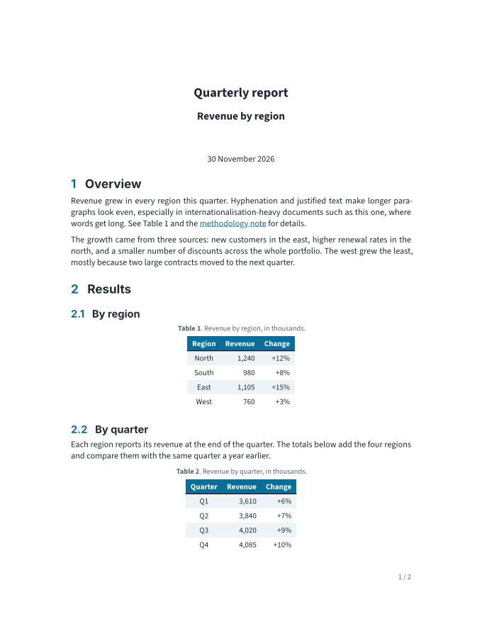
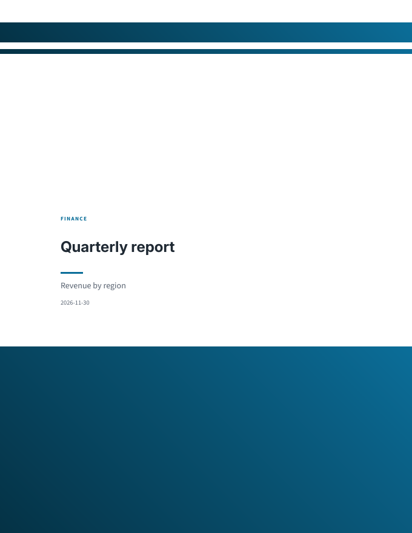
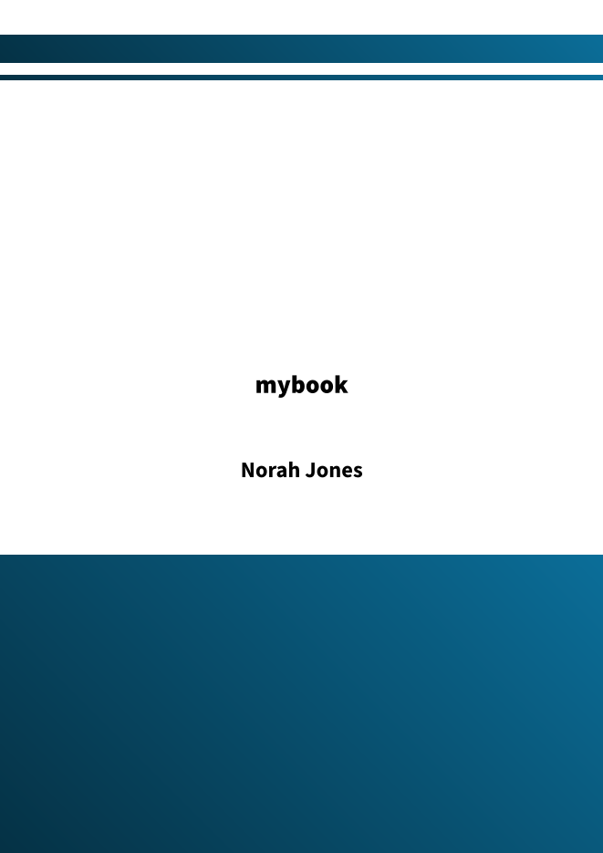

A few weeks ago, I saw someone ask for resources to customise the cover page of a Quarto Typst book.
Since Quarto 1.9, a Typst book uses the [orange-book](https://github.com/quarto-ext/orange-book) template by default, as the [1.9 changelog](https://quarto.org/docs/download/changelog/1.9/) says.
So the question is a fair one.
I use a handful of Typst tricks in my Quarto Typst format extensions, so I thought I would share them.

This post shows ten of them as small partials.
They make a PDF look professional, and none of them makes it less accessible.
Professional does not mean inaccessible.
Each one is a separate file that you can copy and edit.
They work on any Quarto Typst document, but a book needs [a few changes](#book).
Each callout titled "Accessibility" explains how that trick keeps the PDF accessible.

{
  .img-featured
  .img-fluid
  fig-align="center"
  fig-alt=''
  width="600px"
}

## How Partials Work

Quarto builds a Typst PDF in two steps.
First, it turns your document into a Typst source file.
Then Typst compiles that file into the PDF.

A partial is a file that Quarto pastes into that Typst source.
It holds a few lines of Typst, such as a `set` rule or a `show` rule.
Quarto offers two ways to load one.

- `include-in-header` adds your file to the top of the Typst source, after Quarto's own setup.
  Your rules then apply to the whole document.
  The [Typst format page](https://quarto.org/docs/output-formats/typst.html) describes this option.
- `template-partials` replaces one of Quarto's own partials with your file, under the same name.
  The [custom Typst formats page](https://quarto.org/docs/output-formats/typst-custom.html) lists which partials you can replace.
  The [default partials](https://github.com/quarto-dev/quarto-cli/tree/main/src/resources/formats/typst/pandoc/quarto) are on GitHub.
  They are the best place to read what you are replacing.

All ten tricks load through `include-in-header`.
The title block also needs `template-partials`.
If you want to go further and package your partials as an extension, my post on the [document dispatcher](/posts/2026-01-19-typst-document-dispatcher/index.qmd) is the next step.

## The Demo Project

::: {.callout-note}

I made the screenshots and ran every test in this post with Quarto 1.11.9, the current stable release, which ships Typst 0.15.1.
I did not test other versions.

:::

The demo has no `_quarto.yml`.
The demo is a short report, `_report.qmd`, whose front matter holds the `title`, `subtitle`, `kicker`, `date`, `lang` and `number-sections` keys.
Add this `format` block to that front matter to build it with all ten partials, as they stand after the last trick.

```{.yaml filename="format block of each step"}
format:
  typst:
    pdf-standard: ua-1  # <1>
    include-in-header:  # <2>
      - partials/1-tokens.typ
      - partials/2-header-footer.typ
      - partials/3-headings.typ
      - partials/4-code.typ
      - partials/5-tables.typ
      - partials/6-captions.typ
      - partials/7-title-block.typ
      - partials/8-page-stripes.typ
      - partials/9-cover.typ
      - partials/10-cover-decoration.typ
    template-partials:
      - typst-show.typ
```

1. Ask Typst for a tagged PDF that follows PDF/UA-1, with the [`pdf-standard` option](https://quarto.org/docs/reference/formats/typst.html).
   The [Typst accessibility guide](https://typst.app/docs/guides/accessibility/) explains what the standard asks for.
   Typst checks the PDF against the standard and tags it, and `pdfinfo` reports `Tagged: yes` for the final demo.
   For example, an image with no alt text stops the build with the error `PDF/UA-1 error: missing alt text`.
2. Load the partials in this order.
   Removing a line removes that trick, unless a later partial needs it.

Some partials need an earlier one.
In the diagram, an arrow points from a partial to the one it needs.

```{typst}
//| label: fig-partials-tree
//| fig-cap: "The partials that need an earlier partial."
//| echo: false
//| output-filename: "partials-tree.svg"
//| alt: "Dependency diagram. Tokens is needed by every other partial. Page stripes needs header and footer. Cover needs the title block, and cover decoration needs the cover. The typst-show file needs the title block."
//| width: 16cm
//| height: 6cm
#import "@preview/fletcher:0.6.0": diagram, node, edge
#set text(size: 9pt)
#let part(pos, name, label) = node(pos, text(size: 8pt)[#label], name: name, shape: rect, corner-radius: 3pt, inset: 6pt, stroke: 0.7pt, fill: luma(200).transparentize(70%))
#diagram(
  node-stroke: 0.7pt,
  edge-stroke: 0.7pt,
  spacing: (5mm, 11mm),
  part((3, 0), <t1>, [1 Tokens]),
  part((0, 1), <t2>, [2 Header and footer]),
  part((1, 1), <t3>, [3 Headings]),
  part((2, 1), <t4>, [4 Code]),
  part((3, 1), <t5>, [5 Tables]),
  part((4, 1), <t6>, [6 Captions]),
  part((5, 1), <t7>, [7 Title block]),
  part((0, 2), <t8>, [8 Page stripes]),
  part((5, 2), <t9>, [9 Cover]),
  part((4, 2), <ts>, [typst-show.typ]),
  part((5, 3), <t10>, [10 Cover decoration]),
  edge(<t2>, <t1>, "-|>"),
  edge(<t3>, <t1>, "-|>"),
  edge(<t4>, <t1>, "-|>"),
  edge(<t5>, <t1>, "-|>"),
  edge(<t6>, <t1>, "-|>"),
  edge(<t7>, <t1>, "-|>"),
  edge(<t8>, <t2>, "-|>"),
  edge(<t9>, <t7>, "-|>"),
  edge(<ts>, <t7>, "-|>"),
  edge(<t10>, <t9>, "-|>"),
)
```

The heading numbers come from `number-sections: true` in the front matter of `_report.qmd`, because Quarto sets the numbering after the partials run.
The report, the ten partials and `typst-show.typ` are [in the post folder on GitHub](https://github.com/mcanouil/mickael.canouil.fr/tree/main/posts/2026-11-30-typst-partials-tricks/typst).

## Two Ways to Load a Partial {#loading}

The demo uses `include-in-header`, but Quarto offers a second way.
You list your own files under `template-partials`, and you call each one from a partial that you override, with `$name.typ()$`.
It is the way that [quarto-mcanouil](https://m.canouil.dev/quarto-mcanouil/) loads the files of its library.

```{.yaml filename="front matter"}
format:
  typst:
    template-partials:
      - typst-show.typ
      - partials/1-tokens.typ
      - partials/2-header-footer.typ
      - partials/3-headings.typ
```

```{.typst include="typst/typst-show-partials.typ" filename="typst-show.typ"}
```

Put each call on its own line and leave a blank line between two calls.
Without the blank line, Pandoc glues the end of one partial to the start of the next, and Typst stops with an error.

| | `include-in-header` | `template-partials` |
| --- | --- | --- |
| Setup | One line of YAML per file. | One line of YAML per file, plus one `$name.typ()$` call in a partial that you override. |
| Where the file lands | After Quarto's own Typst setup and before `page.typ` and `typst-show.typ`. | Where you call it. |
| Pandoc variables | No. The file is pasted as it is, and `$kicker$` stays as text. | Yes. `$title$` or `$if(kicker)$` work, so a partial can read the YAML. |
| What it replaces | Nothing. | The default partial that you override, here `typst-show.typ`. |
| In a book | Works, as the book section shows. | Overriding `typst-show.typ` removes the setup of orange-book. |
| In an extension | The user has to list the files. | The extension lists them once, and the format gets them with it. |
| Upkeep | None. Quarto's own partials keep working. | You own the partial that you override. Compare it with Quarto's default at every release, or you can miss its fixes and new features. |

::: {.callout-tip}

## Decision

Start with `include-in-header`, because it replaces nothing.
Switch to `template-partials` when a partial must read the YAML, or when you ship the partials with a format extension.
Every Quarto partial that you override becomes yours to maintain, so keep those overrides few and small.

:::

## Tokens {#tokens}

Keep every colour and font in one place, so changing a value changes the whole document.
This principle holds in every programming language, from CSS variables to constants in R, so it applies to Typst too.

```{.typst include="typst/partials/1-tokens.typ" filename="partials/1-tokens.typ"}
```

| Before | After |
| :---: | :---: |
| {.lightbox group="typst-tricks" width="260px"} | {.lightbox group="typst-tricks" width="260px"} |

::: {.callout-note}

## Accessibility: Contrast

I computed the [WCAG 2.x](https://www.w3.org/TR/WCAG21/#contrast-minimum) contrast ratios of these colours with a short script.

- Ink on white is 14.76:1.
- Accent on white is 5.67:1, and so is white on accent.
- Muted on white is 6.18:1, and muted on the tint is 5.54:1.

Body text needs at least 4.5:1, so every pair passes.
Links are underlined, so they do not rely on colour alone.

To compute a ratio, use the [WebAIM contrast checker](https://webaim.org/resources/contrastchecker/) or the [Colour Contrast Analyser](https://www.tpgi.com/color-contrast-checker/) from TPGi.
To pick a palette that stays readable for colour-blind people, try [ColorBrewer](https://colorbrewer2.org/) and [Viz Palette](https://projects.susielu.com/viz-palette).
The [WCAG explanation of contrast](https://www.w3.org/WAI/WCAG21/Understanding/contrast-minimum.html) gives the thresholds.

:::

## Header and Footer {#header-footer}

Add a quiet running header and a page number in the form `n / total`.

```{.typst include="typst/partials/2-header-footer.typ" filename="partials/2-header-footer.typ"}
```

1. A slot for the footer text colour, so that [Page Stripes](#page-stripes) can turn it white on a dark band.
2. `Finance` is the label of the demo.
   If you load this partial with `template-partials`, as in [Two Ways to Load a Partial](#loading), write `[$kicker$]` and the label comes from the `kicker` key of the YAML.

| Before | After |
| :---: | :---: |
| {.lightbox group="typst-tricks" width="260px"} | {.lightbox group="typst-tricks" width="260px"} |

::: {.callout-note}

## Accessibility: Size and context

The text is `0.85em` of the 11 pt body, which is about 9.35 pt, so it stays above 9 pt.
The page counter needs `context`, because its value is only known once Typst lays out the page.

:::

## Headings {#headings}

Colour the heading numbers and keep a heading from being stranded at the bottom of a page.

```{.typst include="typst/partials/3-headings.typ" filename="partials/3-headings.typ"}
```

| Before | After |
| :---: | :---: |
| {.lightbox group="typst-tricks" width="260px"} | {.lightbox group="typst-tricks" width="260px"} |

::: {.callout-note}

## Accessibility: Real headings

The partial restyles real headings.
It does not fake them with big text, so the PDF keeps its heading structure.
The numbers come from `number-sections: true`, because Quarto's `article()` sets the numbering after the partials run.
The partial only styles the number.

:::

## Code {#code}

Show code in a calm light block that never splits across pages and never turns characters into symbols.

```{.typst include="typst/partials/4-code.typ" filename="partials/4-code.typ"}
```

| Before | After |
| :---: | :---: |
| {.lightbox group="typst-tricks" width="260px"} | {.lightbox group="typst-tricks" width="260px"} |

::: {.callout-note}

## Accessibility: Ligatures and page breaks

Code that looks different from what you typed is hard to read.
With only `ligatures: false`, Fira Code still drew `|>` as a triangle, so I also turn off the `calt` feature with `features: ("calt": 0)`.
The symbols `!=`, `<-` and `>=` then show as typed.
The `breakable: false` setting keeps a block on one page.
This matters most in teaching materials, where learners must see exactly the characters they have to type.
Code text is `0.8em` of the body, which is 8.8 pt, so it is a little under 9 pt.
You can enlarge it with `#show raw: set text(size: 9.5pt)`, and I use points there because an `em` value would apply to the already reduced size.

:::

## Tables {#tables}

Give tables a filled header and light stripes.
These rules are plain Typst and need no library such as `gt` or `great_tables`, so every table gets the style, including a simple Markdown table in Quarto, and not only the tables that R or Python produce.
My post on [branded figures and tables](/posts/2026-04-15-quarto-brand-figures-tables/index.qmd) covers those libraries.

```{.typst include="typst/partials/5-tables.typ" filename="partials/5-tables.typ"}
```

| Before | After |
| :---: | :---: |
| {.lightbox group="typst-tricks" width="260px"} | {.lightbox group="typst-tricks" width="260px"} |

::: {.callout-note}

## Accessibility: Header row

The partial styles the header row.
It does not replace it, so the table keeps its real header row.
Tagged PDFs rely on `table.header` to tell readers and screen readers which cells are headings.
The stripes only help the eye, because the header carries the meaning and colour is never the only signal.

:::

## Captions {#captions}

Make captions small and muted, with the label in bold.
This one is a matter of taste.
I find it easier to read when "Table 1" and the caption text look different, so the label stays bold and the caption is smaller and muted.

```{.typst include="typst/partials/6-captions.typ" filename="partials/6-captions.typ"}
```

| Before | After |
| :---: | :---: |
| {.lightbox group="typst-tricks" width="260px"} | {.lightbox group="typst-tricks" width="260px"} |

::: {.callout-note}

## What I left out

I first wrote a partial that justified the text and set the language.
Quarto already justifies text, and it reads `lang` from the YAML, so that partial added nothing.
Set `lang: en-GB` in the document and Typst uses it for hyphenation.

:::

## Title Block {#title-block}

Replace the default title with a kicker, a title, a short rule, a subtitle and a date.

```{.typst include="typst/partials/7-title-block.typ" filename="partials/7-title-block.typ"}
```

This one needs a second file, because Quarto decides what it passes to the title block in `typst-show.typ`.
Quarto loads that file with `template-partials`.

```{.typst include="typst/typst-show.typ" filename="typst-show.typ"}
```

| Before | After |
| :---: | :---: |
| {.lightbox group="typst-tricks" width="260px"} | {.lightbox group="typst-tricks" width="260px"} |

::: {.callout-warning}

## The only `typst-show.typ` override

This file replaces Quarto's [default `typst-show.typ`](https://github.com/quarto-dev/quarto-cli/blob/main/src/resources/formats/typst/pandoc/quarto/typst-show.typ), so it drops what the default does.
That includes fonts, the table of contents and brand settings.
Read the default before you copy mine, and keep what you need.

`$title$` and `$kicker$` are Pandoc variables.
Pandoc fills them from the YAML, and `kicker` is a custom field that I added to the document.
My file does not pass the title to `article()`, which then sets the document title to nothing.
So I set it below the `article()` call with `#set document(title: [$title$])`.
The PDF then keeps its title for screen readers and for the running header.
The short rule under the title is wrapped in `pdf.artifact()` to state that it is decoration.
Typst already treats a line as an artifact, so the wrapper is optional here.

:::

## Page Stripes {#page-stripes}

The decoration of this demo is a thick and a thin stripe at the top and a gradient band at the bottom, all in the accent colour.
This trick puts them on every page, with the band behind the footer.
The [cover](#cover-page) reuses the same style later in the post.

```{.typst include="typst/partials/8-page-stripes.typ" filename="partials/8-page-stripes.typ"}
```

1. Turns the footer text white, through the slot of [Header and Footer](#header-footer).

| Before | After |
| :---: | :---: |
| {.lightbox group="typst-tricks" width="260px"} | {.lightbox group="typst-tricks" width="260px"} |

::: {.callout-note}

## Accessibility: Decoration and contrast

Screen readers should skip decoration.
Typst already marks page backgrounds and shapes as [artifacts](https://typst.app/docs/reference/pdf/artifact/), so it skips the stripes and the band.
I still wrap them in `pdf.artifact()` to say so.
The band is dark, so the footer text turns white, which is 5.67:1 on the lightest end of the gradient.
Text on a band needs its contrast checked again.

:::

## Cover Page {#cover-page}

Give the title block a page of its own, centred vertically, with no header or footer.

```{.typst include="typst/partials/9-cover.typ" filename="partials/9-cover.typ"}
```

1. A slot for the cover decoration.
   It stays empty until [Cover Decoration](#cover-decoration) fills it.

| Before | After |
| :---: | :---: |
| {.lightbox group="typst-tricks" width="260px"} | {.lightbox group="typst-tricks" width="260px"} |

::: {.callout-note}

## Why `cover-art` is a state

A Typst closure captures the variables it uses when you define it.
A later `#let` cannot change a function that already exists.
A `state` is read when the page is built, so [Cover Decoration](#cover-decoration) can fill the slot after this partial has run.

:::

## Cover Decoration {#cover-decoration}

Fill the cover slot with a gradient band at the bottom and two stripes at the top.

```{.typst include="typst/partials/10-cover-decoration.typ" filename="partials/10-cover-decoration.typ"}
```

1. Fills the slot of [Cover Page](#cover-page).

| Before | After |
| :---: | :---: |
| {.lightbox group="typst-tricks" width="260px"} | {.lightbox group="typst-tricks" width="260px"} |

::: {.callout-note}

## Accessibility: No text in the art

The decoration is only shapes and it sits behind the content.
The title is dark ink on white, and the gradient band at the bottom holds nothing, so the cover text keeps its contrast.

:::

## Using the Tricks in a Quarto Book {#book}

A Quarto book project with `format: typst` uses the [orange-book extension](https://github.com/quarto-ext/orange-book), which Quarto bundles since 1.9.
It wraps the [orange-book Typst package](https://typst.app/universe/package/orange-book) by Flavio Barisi, which is based on [his original template](https://github.com/flavio20002/typst-orange-template).
The package draws the cover and the chapter headings itself, and the [`typst-show.typ` of the extension](https://github.com/quarto-ext/orange-book/blob/main/_extensions/orange-book/typst-show.typ) sets it up.
I tested the partials in a book made with `quarto create project book`, with Quarto 1.11.9 and orange-book 0.7.1, and `pdf-standard: ua-1` still gave a tagged PDF.

| Trick | In a book |
| --- | --- |
| Tokens, Headings, Code, Tables, Captions | Work as in a document, and the caption number follows the chapter, as in "Table 1.1". |
| Header and Footer | The footer works. The orange-book header stays, because the template sets it after your partial. |
| Page Stripes | Works on every page, cover included. Load the footer partial before it, because that one holds the `footer-ink` state. Without it, the build stops with `unknown variable: footer-ink`. |
| Title Block, Cover Page, Cover Decoration | Do not use them. They replace `typst-show.typ`, which holds the setup of orange-book, and the book then renders as a single page. |

The supported way to change the cover is a [brand file](https://quarto.org/docs/authoring/brand.html), written in the [brand.yml](https://posit-dev.github.io/brand-yml/) format.
The extension passes `color.primary` as the main colour, and the title box uses it lightened by 70%.
It also passes `logo.medium`, which the package puts at the top of the cover, 3 cm wide.
The package has other cover options, such as `cover`, `cover-background` and `copyright`, but the extension does not read them from the YAML.
I proposed a `cover` key for them in a [pull request](https://github.com/quarto-ext/orange-book/pull/7).
The wider request, to expose more options of the package in the YAML, is [quarto-cli issue 14270](https://github.com/quarto-dev/quarto-cli/issues/14270).
Until it is merged, you can add the keys yourself.
Copy the `typst-show.typ` of the extension, add these lines after its `main-color` line, and list the file under `template-partials`.
You then maintain that copy at every Quarto release.

```{.typst filename="added to typst-show.typ"}
$if(cover.background)$
  cover-background: {
    let name = "$cover.background$"
    if name == "none" { none } else { brand-color.at(name) }
  },
$endif$
$if(cover.image)$
  cover: image("$cover.image$"$if(cover.alt)$, alt: "$cover.alt$"$endif$),
$endif$
$if(cover.copyright)$
  copyright: [$cover.copyright$],
$endif$
```

```{.yaml filename="_quarto.yml"}
format:
  typst:
    template-partials:
      - typst-show.typ
    cover:
      background: secondary
      image: cover.png
      alt: A description of the image.
      copyright: Copyright 2026 Jane Smith.
```

`background` is the name of a colour of the brand file, because Pandoc escapes the `#` of a hex value.
The name `none` drops the light box behind the title, which suits a cover that you decorate yourself.
Without `alt`, `pdf-standard: ua-1` stops the build, so the image always has a description.

{.lightbox group="typst-tricks" width="237px" fig-align="center"}

This cover combines `background: none` with `book-cover.typ`.

::: {.callout-note collapse="true"}

## The full `typst-show.typ`

This is the file of Quarto 1.11.9 with the lines above added.

```{.typst include="typst/book-typst-show.typ" filename="typst-show.typ"}
```

:::

The cover is the one thing you cannot reach with those partials.
orange-book draws it as the first page, so the decoration has to target that page.
This partial paints the stripes and the band on page 1 only, in the same way as the cover of the demo.
It overrides nothing, so it is the lighter option.

```{.typst include="typst/book-cover.typ" filename="book-cover.typ"}
```

Load it after `1-tokens.typ`, because it reads `accent` from there.

| Before | After |
| :---: | :---: |
| {.lightbox group="typst-tricks" width="237px"} | {.lightbox group="typst-tricks" width="237px"} |

::: {.callout-note}

## Accessibility: Check the cover contrast

The title box of orange-book stays in the middle of the page, away from the gradient, so its text keeps its contrast.
If you move the band under the box, check the contrast again, as for any text on a band.

:::

If the book needs more than that, write your own Typst format and use it for books.
My clinical study report does this: one format extension renders both a Quarto book and a single document, and a profile picks between them.
It is described in [A Clinical Study Report in Quarto, End to End](/posts/2026-08-17-quarto-clinical-report/index.qmd).

## Where to Go Next

- To package partials like these in a format extension, follow the tutorial in [Part 1](/posts/2026-02-27-typst-template-tutorial-part1/index.qmd) and in [Part 2](/posts/2026-03-05-typst-template-tutorial-part2/index.qmd).
- To see a branded Typst PDF built from an extension, a template and a brand file, read [A Clinical Study Report in Quarto, End to End](/posts/2026-08-17-quarto-clinical-report/index.qmd).
- To keep figures and tables in the colours of your document, read [Branded Figures and Tables in R and Python with Quarto](/posts/2026-04-15-quarto-brand-figures-tables/index.qmd).
- To draw figures natively in Typst, read [Gribouille: a Grammar of Graphics for Typst](/posts/2026-05-20-gribouille-grammar-of-graphics-for-typst/index.qmd).
- To serve several document types from one format, read [Document-Type Dispatching in Quarto Typst Extensions](/posts/2026-01-19-typst-document-dispatcher/index.qmd).
- To see which partials you can replace, read the [custom Typst formats](https://quarto.org/docs/output-formats/typst-custom.html) page of the Quarto documentation.
- To see a full example, look at [quarto-mcanouil](https://m.canouil.dev/quarto-mcanouil/).

If you try these partials, I would like to hear how it goes.
Drop a comment in the form below.
