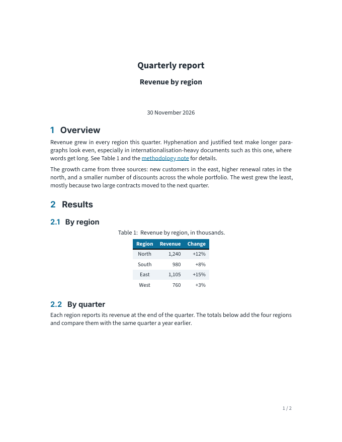
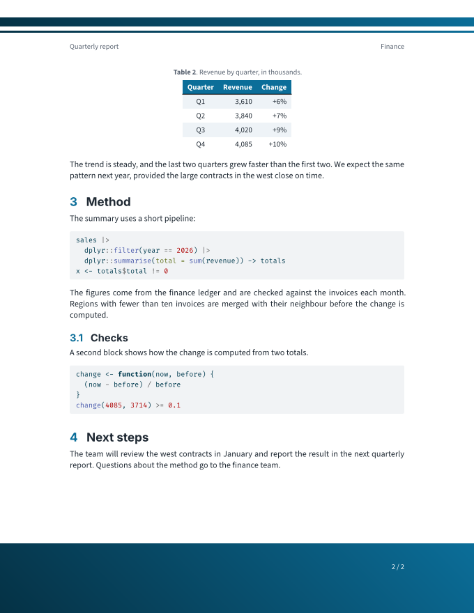
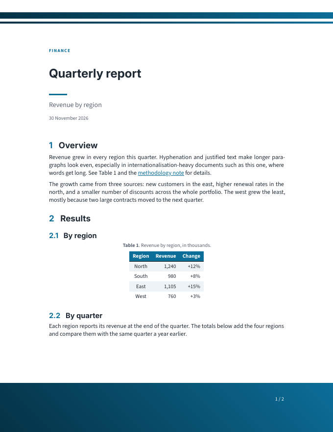
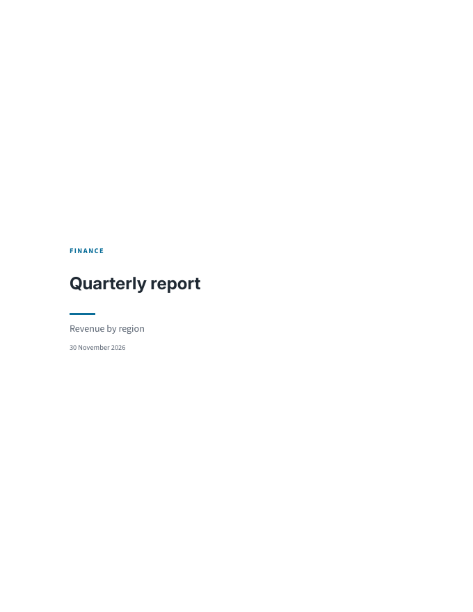
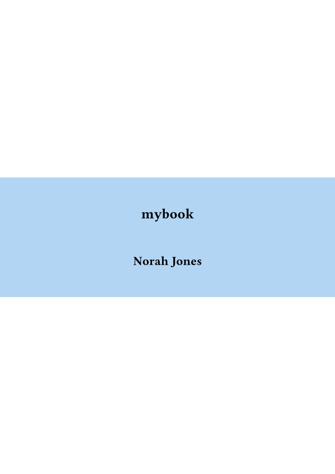
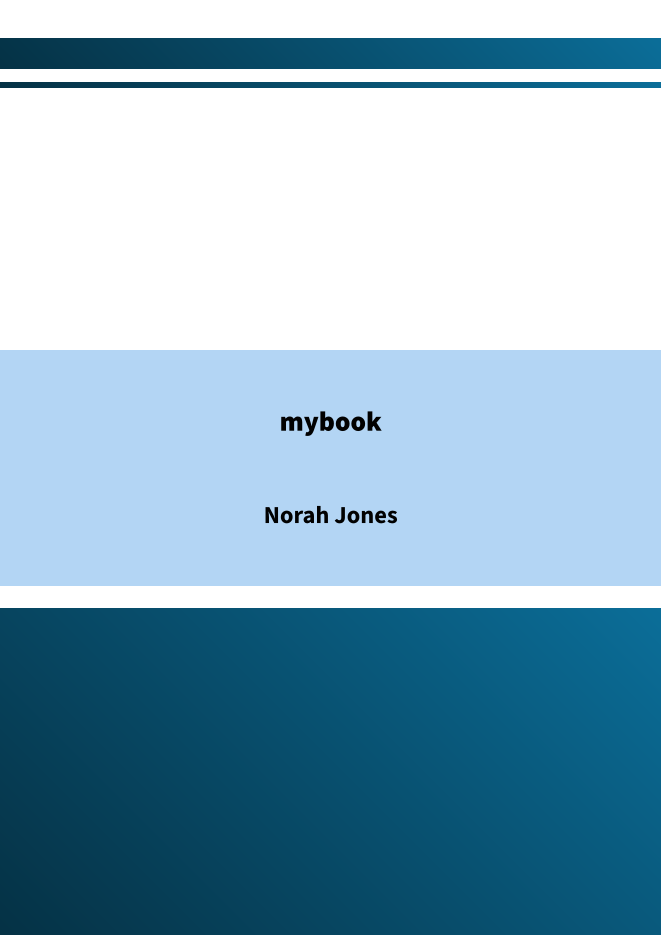

A few weeks ago, I saw someone ask for resources to customise the cover page of a Quarto Typst book.
Since Quarto 1.9, a Typst book uses the [orange-book](https://github.com/quarto-ext/orange-book) template by default, as the [1.9 changelog](https://quarto.org/docs/download/changelog/1.9/) says.
So the question is a fair one.
I use a handful of Typst tricks in my Quarto Typst format extensions, so I thought I would share them.

This post shows ten of them as small partials.
They make a PDF look professional, and none of them makes it less accessible.
Professional does not mean inaccessible.
Each one is a separate file, so you can copy it and edit it without touching the others.
A few build on an earlier one, and the demo section says which.
They work on any Quarto Typst document, and [one section](#book) covers what changes in a book.
A callout titled "Accessibility" explains how the trick keeps the PDF accessible, and the other callouts cover other details.

{
  .img-featured
  .img-fluid
  fig-align="center"
  fig-alt=''
  width="600px"
}

## How Partials Work

Quarto builds a Typst PDF in two steps.
First, it turns your document into a Typst source file.
Then Typst compiles that file into the PDF.

A partial is a file that Quarto pastes into that Typst source.
It holds a few lines of Typst, such as a `set` rule or a `show` rule.
Quarto offers two ways to load one.

- `include-in-header` adds your file to the top of the Typst source, after Quarto's own setup.
  Your rules then apply to the whole document.
  The [Typst format page](https://quarto.org/docs/output-formats/typst.html) describes this option.
- `template-partials` replaces one of Quarto's own partials with your file, under the same name.
  The [custom Typst formats page](https://quarto.org/docs/output-formats/typst-custom.html) lists which partials you can replace.
  The [default partials](https://github.com/quarto-dev/quarto-cli/tree/main/src/resources/formats/typst/pandoc/quarto) are on GitHub.
  They are the best place to read what you are replacing.

All ten tricks load through `include-in-header`.
The title block also needs `template-partials`.
If you want to go further and package your partials as an extension, my post on the [document dispatcher](/posts/2026-01-19-typst-document-dispatcher/index.qmd) is the next step.

## The Demo Project

::: {.callout-note}

I made the screenshots and ran every test in this post with Quarto 1.11.9, which ships Typst 0.15.1.
The demo also builds with Quarto 1.10.19.
I did not test older versions.
The demo uses `pdf-standard` and `pdf.artifact()`.
The [Quarto 1.9 changelog](https://quarto.org/docs/download/changelog/1.9/) lists the `pdf-standard` option and says that Quarto 1.9 ships Typst 0.14.2.
The [Typst 0.14 changelog](https://typst.app/docs/changelog/0.14.0/) lists `pdf.artifact()` and PDF/UA-1 export.
So the demo needs Quarto 1.9 or newer.

:::

The demo has no `_quarto.yml`.
Here is the `format` block that `typst/render-steps.sh` adds to each step, as it stands after the last trick.
The script puts it on top of the front matter of `_report.qmd`, which holds the `title`, `subtitle`, `kicker`, `date`, `lang` and `number-sections` keys.

```{.yaml filename="format block of each step"}
format:
  typst:
    pdf-standard: ua-1  # <1>
    include-in-header:  # <2>
      - partials/1-tokens.typ
      - partials/2-header-footer.typ
      - partials/3-headings.typ
      - partials/4-code.typ
      - partials/5-tables.typ
      - partials/6-captions.typ
      - partials/7-title-block.typ
      - partials/8-page-stripes.typ
      - partials/9-cover.typ
      - partials/10-cover-decoration.typ
    template-partials:
      - typst-show.typ
```

1. Ask Typst for a tagged PDF that follows PDF/UA-1, with the [`pdf-standard` option](https://quarto.org/docs/reference/formats/typst.html).
   The [Typst accessibility guide](https://typst.app/docs/guides/accessibility/) explains what the standard asks for.
   Typst checks the PDF against the standard and tags it, and `pdfinfo` reports `Tagged: yes` for the final demo.
   In my tests, an image with no alt text stops the build with the error `PDF/UA-1 error: missing alt text`.
2. Load the partials in this order.
   Removing a line removes that trick, unless a later partial needs it.

Some partials need an earlier one.

- Every partial after the first reads the colours and fonts of `1-tokens.typ`.
- `8-page-stripes.typ` needs `2-header-footer.typ`, and `10-cover-decoration.typ` needs `9-cover.typ`.
- `9-cover.typ` and `typst-show.typ` need `7-title-block.typ`.
- The others, such as `3-headings.typ` and `4-code.typ`, need only the first partial.

The heading numbers come from `number-sections: true` in the front matter of `_report.qmd`, because Quarto sets the numbering after the partials run.
The demo and the script that builds it are [in the post folder on GitHub](https://github.com/mcanouil/mickael.canouil.fr/tree/main/posts/2026-11-30-typst-partials-tricks/typst).
To build the PDF after each trick, run `typst/render-steps.sh` from that folder.

## Two Ways to Load a Partial {#loading}

The demo uses `include-in-header`, but Quarto offers a second way.
You list your own files under `template-partials`, and you call each one from a partial that you override, with `$name.typ()$`.
It is the way that [quarto-mcanouil](https://m.canouil.dev/quarto-mcanouil/) loads the files of its library.

```{.yaml filename="front matter"}
format:
  typst:
    template-partials:
      - typst-show.typ
      - partials/1-tokens.typ
      - partials/2-header-footer.typ
      - partials/3-headings.typ
```

```{.typst include="typst/typst-show-partials.typ" filename="typst-show.typ"}
```

I tested this with the first three partials, and the PDF came out tagged.
Put each call on its own line and leave a blank line between two calls.
Without the blank line, Pandoc glues the end of one partial to the start of the next, and Typst stops with an error.

| | `include-in-header` | `template-partials` |
| --- | --- | --- |
| Setup | One line of YAML per file. | One line of YAML per file, plus one `$name.typ()$` call in a partial that you override. |
| Where the file lands | After Quarto's own Typst setup and before `page.typ` and `typst-show.typ`. | Where you call it. |
| Pandoc variables | No. The file is pasted as it is, and `$kicker$` stays as text. | Yes. `$title$` or `$if(kicker)$` work, so a partial can read the YAML. |
| What it replaces | Nothing. | The default partial that you override, here `typst-show.typ`. |
| In a book | Works, as the book section shows. | Overriding `typst-show.typ` removes the setup of orange-book. |
| In an extension | The user has to list the files. | The extension lists them once, and the format gets them with it. |

I tested the variable row by putting `$kicker$` in each kind of file.
The partial printed the value of `kicker` in the header, and the `include-in-header` file kept the literal text.

My rule is simple.
Use `include-in-header` for small tweaks that do not read the metadata, because nothing else changes.
Use `template-partials` when a partial needs the YAML, or when you package the partials in a format extension.

## Tokens {#tokens}

Keep every colour and font in one place, so changing a value changes the whole document.

```{.typst include="typst/partials/1-tokens.typ" filename="partials/1-tokens.typ"}
```

| Before | After |
| --- | --- |
| {.lightbox group="typst-tricks"} | {.lightbox group="typst-tricks"} |

::: {.callout-note}

## Accessibility: Contrast

I computed the [WCAG 2.x](https://www.w3.org/TR/WCAG21/#contrast-minimum) contrast ratios of these colours with a short script.

- Ink on white is 14.76:1.
- Accent on white is 5.67:1, and so is white on accent.
- Muted on white is 6.18:1, and muted on the tint is 5.54:1.

Body text needs at least 4.5:1, so every pair passes.
Links are underlined, so they do not rely on colour alone.

:::

## Header and Footer {#header-footer}

Add a quiet running header and a page number in the form `n / total`.

```{.typst include="typst/partials/2-header-footer.typ" filename="partials/2-header-footer.typ"}
```

| Before | After |
| --- | --- |
| {.lightbox group="typst-tricks"} | {.lightbox group="typst-tricks"} |

::: {.callout-note}

## Accessibility: Size and context

The text is `0.85em` of the 11 pt body, which is about 9.35 pt, so it stays above 9 pt.
The page counter needs `context`, because its value is only known once Typst lays out the page.
The right slot of the header says `Finance`, which is the label of the demo, so replace it with your own.

:::

## Headings {#headings}

Colour the heading numbers and keep a heading from being stranded at the bottom of a page.

```{.typst include="typst/partials/3-headings.typ" filename="partials/3-headings.typ"}
```

| Before | After |
| --- | --- |
| {.lightbox group="typst-tricks"} | {.lightbox group="typst-tricks"} |

::: {.callout-note}

## Accessibility: Real headings

The partial restyles real headings.
It does not fake them with big text, so the PDF keeps its heading structure.
The numbers come from `number-sections: true`, because Quarto's `article()` sets the numbering after the partials run.
The partial only styles the number.

:::

## Code {#code}

Show code in a calm light block that never splits across pages and never turns characters into symbols.

```{.typst include="typst/partials/4-code.typ" filename="partials/4-code.typ"}
```

| Before | After |
| --- | --- |
| {.lightbox group="typst-tricks"} | {.lightbox group="typst-tricks"} |

::: {.callout-note}

## Accessibility: Ligatures and page breaks

Code that looks different from what you typed is hard to read.
With only `ligatures: false`, Fira Code still drew `|>` as a triangle, so I also turn off the `calt` feature with `features: ("calt": 0)`.
The symbols `!=`, `<-` and `>=` then show as typed.
The `breakable: false` setting keeps a block on one page.
Code text is `0.8em` of the body, which is 8.8 pt, so it is a little under 9 pt.
You can enlarge it with `#show raw: set text(size: 9.5pt)`, and I use points there because an `em` value would apply to the already reduced size.

:::

## Tables {#tables}

Give tables a filled header and light stripes.

```{.typst include="typst/partials/5-tables.typ" filename="partials/5-tables.typ"}
```

| Before | After |
| --- | --- |
| {.lightbox group="typst-tricks"} | {.lightbox group="typst-tricks"} |

::: {.callout-note}

## Accessibility: Header row

The partial styles the header row.
It does not replace it, so the table keeps its real header row.
Tagged PDFs rely on `table.header` to tell readers and screen readers which cells are headings.
The stripes only help the eye, because the header carries the meaning and colour is never the only signal.

:::

## Captions {#captions}

Make captions small and muted, with the label in bold.

```{.typst include="typst/partials/6-captions.typ" filename="partials/6-captions.typ"}
```

| Before | After |
| --- | --- |
| {.lightbox group="typst-tricks"} | {.lightbox group="typst-tricks"} |

::: {.callout-note}

## What I left out

I first wrote a partial that justified the text and set the language.
Quarto already justifies text, and it reads `lang` from the YAML, so that partial added nothing.
Set `lang: en-GB` in the document and Typst uses it for hyphenation.

:::

## Title Block {#title-block}

Replace the default title with a kicker, a title, a short rule, a subtitle and a date.

```{.typst include="typst/partials/7-title-block.typ" filename="partials/7-title-block.typ"}
```

This one needs a second file, because Quarto decides what it passes to the title block in `typst-show.typ`.
Here it is, loaded with `template-partials`.

```{.typst include="typst/typst-show.typ" filename="typst-show.typ"}
```

| Before | After |
| --- | --- |
| {.lightbox group="typst-tricks"} | {.lightbox group="typst-tricks"} |

::: {.callout-warning}

## The only `typst-show.typ` override

This file replaces Quarto's [default `typst-show.typ`](https://github.com/quarto-dev/quarto-cli/blob/main/src/resources/formats/typst/pandoc/quarto/typst-show.typ), so it drops what the default does.
That includes fonts, the table of contents and brand settings.
Read the default before you copy mine, and keep what you need.

`$title$` and `$kicker$` are Pandoc variables.
Pandoc fills them from the YAML, and `kicker` is a custom field that I added to the document.
My file does not pass the title to `article()`, which then sets the document title to nothing.
So I set it below the `article()` call with `#set document(title: [$title$])`.
The PDF then keeps its title for screen readers and for the running header.
The short rule under the title is wrapped in `pdf.artifact()` to state that it is decoration.
Typst already treats a line as an artifact, so the wrapper is optional here.

:::

## Page Stripes {#page-stripes}

Echo the cover on every page with a thick and a thin stripe at the top, and a gradient band behind the footer.

```{.typst include="typst/partials/8-page-stripes.typ" filename="partials/8-page-stripes.typ"}
```

| Before | After |
| --- | --- |
| {.lightbox group="typst-tricks"} | {.lightbox group="typst-tricks"} |

::: {.callout-note}

## Accessibility: Decoration and contrast

Screen readers should skip the stripes and the band.
Typst already marks page backgrounds, headers and footers as [artifacts](https://typst.app/docs/reference/pdf/artifact/), and it marks paths and shapes as artifacts too.
I removed `pdf.artifact()` from a copy of the decorative partials and rendered with `pdf-standard: ua-1`.
Neither Typst nor Quarto reported an error, and [veraPDF](https://verapdf.org/) still passed it.
Quarto runs veraPDF on the PDF when you have installed it with `quarto install verapdf`, as the [1.9 changelog](https://quarto.org/docs/download/changelog/1.9/) describes.
So the experiment confirms it: the stripes, the band and the title rule are artifacts without the wrapper.
I keep `pdf.artifact()` because it states the intent, and because content that Typst does not mark itself, such as a decorative image or text, needs it.

The band is dark, so trick 2 holds a `footer-ink` state for the footer text colour, and this partial sets it to white.
White on the lightest end of the gradient, which is the accent colour, is 5.67:1.
Text on a band needs its contrast checked again.

:::

## Cover Page {#cover-page}

Give the title block a page of its own, centred vertically, with no header or footer.

```{.typst include="typst/partials/9-cover.typ" filename="partials/9-cover.typ"}
```

| Before | After |
| --- | --- |
| {.lightbox group="typst-tricks"} | {.lightbox group="typst-tricks"} |

::: {.callout-note}

## Why `cover-art` is a state

A Typst closure captures the variables it uses when you define it.
A later `#let` cannot change a function that already exists.
A `state` is read when the page is built, so trick 10 can fill the slot after this partial has run.

:::

## Cover Decoration {#cover-decoration}

Fill the cover slot with a gradient band at the bottom and two stripes at the top.

```{.typst include="typst/partials/10-cover-decoration.typ" filename="partials/10-cover-decoration.typ"}
```

| Before | After |
| --- | --- |
| {.lightbox group="typst-tricks"} | {.lightbox group="typst-tricks"} |

::: {.callout-note}

## Accessibility: No text in the art

The decoration is only shapes and it sits behind the content.
The title is dark ink on white, and the gradient band at the bottom holds nothing, so the cover text keeps its contrast.

:::

## Using the Tricks in a Quarto Book {#book}

A Quarto book project with `format: typst` uses the [orange-book extension](https://github.com/quarto-ext/orange-book), which Quarto bundles since 1.9.
It wraps the [orange-book Typst package](https://typst.app/universe/package/orange-book) by Flavio Barisi, which is based on [his original template](https://github.com/flavio20002/typst-orange-template).
The package draws the cover and the chapter headings itself, and the [`typst-show.typ` of the extension](https://github.com/quarto-ext/orange-book/blob/main/_extensions/orange-book/typst-show.typ) sets it up.
I tested the partials in a book made with `quarto create project book`, with Quarto 1.11.9 and orange-book 0.7.1, and `pdf-standard: ua-1` still gave a tagged PDF.

| Trick | In a book |
| --- | --- |
| Tokens, Headings, Code, Tables, Captions | Work as in a document, and the caption number follows the chapter, as in "Table 1.1". |
| Header and Footer | The footer works. The orange-book header stays, because the template sets it after your partial. |
| Page Stripes | Works on every page, cover included. Load the footer partial before it, because that one holds the `footer-ink` state. Without it, the build stops with `unknown variable: footer-ink`. |
| Title Block, Cover Page, Cover Decoration | Do not use them. They replace `typst-show.typ`, which holds the setup of orange-book, and the book then renders as a single page. |

The supported way to change the cover is a [brand file](https://quarto.org/docs/authoring/brand.html), written in the [brand.yml](https://posit-dev.github.io/brand-yml/) format.
The extension passes `color.primary` as the main colour, and the title box uses it lightened by 70%.
It also passes `logo.medium`, which the package puts at the top of the cover, 3 cm wide.
The package has other cover options, such as `cover`, `cover-background` and `copyright`, but the extension does not read them from the YAML.

The cover is the one thing you cannot reach with those partials.
orange-book draws it as the first page, so the decoration has to target that page.
This partial paints the stripes and the band on page 1 only, in the same way as the cover of the demo.

```{.typst include="typst/book-cover.typ" filename="book-cover.typ"}
```

Load it after `1-tokens.typ`, because it reads `accent` from there.

| Before | After |
| --- | --- |
| {.lightbox group="typst-tricks"} | {.lightbox group="typst-tricks"} |

::: {.callout-note}

## Accessibility: Check the cover contrast

The title box of orange-book stays in the middle of the page, away from the gradient, so its text keeps its contrast.
If you move the band under the box, check the contrast again, as for any text on a band.

:::

## Where to Go Next

- To package partials like these in an extension, read my post on the [document dispatcher](/posts/2026-01-19-typst-document-dispatcher/index.qmd).
- To build a Typst template with Lua and Typst working together, follow the tutorial in [Part 1](/posts/2026-02-27-typst-template-tutorial-part1/index.qmd) and in [Part 2](/posts/2026-03-05-typst-template-tutorial-part2/index.qmd).
- To see which partials you can replace, read the [custom Typst formats](https://quarto.org/docs/output-formats/typst-custom.html) page of the Quarto documentation.
- To see a full example, look at [quarto-mcanouil](https://m.canouil.dev/quarto-mcanouil/).

If you try these partials, I would like to hear how it goes.
Questions are welcome in the [discussions](https://github.com/mcanouil/mickael.canouil.fr/discussions), and problems in the [issues](https://github.com/mcanouil/mickael.canouil.fr/issues).
